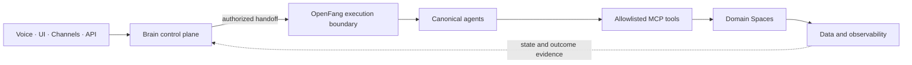

# VibeMind V1

[](https://github.com/Flissel/vibemind/actions/workflows/open-source-checks.yml)
[](LICENSE)

VibeMind is a modular, open-source AI operating system that connects a cognitive
routing layer, agent runtimes, voice and desktop interfaces, automation tools,
and domain-specific workspaces in one repository.

> [!IMPORTANT]
> VibeMind is under active development. The complete stack is intended for
> Windows 11 and includes optional services that require Docker, API keys, and
> substantial local resources. Start with the dry-run commands below.

## What is included

- **Brain** for intent classification and cognitive routing
- **OpenFang** as the agent execution boundary
- **Voice and Electron UI** for realtime interaction (lives in the `vibemind-os/voice` submodule; the desktop launcher is a separate Tauri app)
- **Desktop automation** and browser-control integrations
- **Coding, marketing, ideas, scheduling, video, and other Spaces**
- **MCP services** and bridges for tool and agent interoperability
- **Docker Swarm infrastructure** for the integrated runtime

The root repository is the orchestration and operations layer. Most product
components live in the `vibemind-os` Git submodule, which contains additional
submodules. Clone recursively so that the complete source tree is available.

> [!NOTE]
> Publication is still being prepared. At the documentation audit on
> 2026-08-09, the root repository and `vibemind-os` were private, so an
> anonymous recursive clone and the default GitHub Actions checkout could not
> yet fetch the full tree. See the
> [documentation audit](docs/DOCUMENTATION_AUDIT.md#open-source-checkout).

## Architecture at a glance



Brain owns intent, planning, and routing decisions. OpenFang owns agent
resolution, approval, and execution. Cognitive requests must follow this chain
or return an explicit fail-closed error; they must not silently fall back to a
direct provider or application path.

Read the [detailed architecture](docs/ARCHITECTURE.md), browse the
[canonical catalog for all 13 Spaces](docs/SPACES.md), review the
[documentation audit](docs/DOCUMENTATION_AUDIT.md), or open the
[standalone visual diagram](docs/architecture.html).

## Quick start

### 1. Prerequisites

Install the following before cloning:

- [Git](https://git-scm.com/downloads)
- Windows 11 with PowerShell 7 recommended
- [Python](https://www.python.org/downloads/) 3.11 or newer
- Python 3.12 via the Windows `py` launcher for the Voice module
- [Node.js](https://nodejs.org/) 18 or newer
- [Docker Desktop](https://docs.docker.com/desktop/setup/install/windows-install/)
  with Docker Compose; required for the integrated stack
- Optional: [Ollama](https://ollama.com/) for local models

You also need at least one supported LLM API key: `OPENROUTER_API_KEY`,
`OPENAI_API_KEY`, or `ANTHROPIC_API_KEY`.

### 2. Clone the complete repository

On Windows, enable long paths first — several submodules exceed the legacy
260-character limit and the clone fails without it:

```powershell
git config --global core.longpaths true
```

```powershell
git clone --recurse-submodules https://github.com/Flissel/vibemind.git
Set-Location vibemind
```

Clone into a short path (for example `C:\srcibemind`); a deep target
directory can still exceed the limit.

If you already cloned without submodules:

```powershell
git submodule sync --recursive
git submodule update --init --recursive
```

To update an existing checkout without changing your local branch:

```powershell
git pull --ff-only
git submodule sync --recursive
git submodule update --init --recursive
```

### 3. Run the setup wizard

```powershell
pwsh -File .\setup.ps1
```

The wizard checks prerequisites, asks which modules to enable, creates local
virtual environments, installs selected dependencies, and writes local `.env`
files. Secrets are ignored by Git. Never commit an `.env` file.

Useful setup options:

```powershell
# Use values already present in .env and accept module defaults
pwsh -File .\setup.ps1 -NonInteractive

# Configure non-Docker modules only
pwsh -File .\setup.ps1 -SkipDocker

# Recreate generated module configuration files
pwsh -File .\setup.ps1 -Force
```

If Windows blocks local scripts, allow them only for the current process:

```powershell
Set-ExecutionPolicy -Scope Process -ExecutionPolicy Bypass
```

### 4. Preview, then start

For an interactive development session:

```powershell
.\Vibemind.debug.ps1 -DryRun
.\Vibemind.debug.ps1
```

For the validated server-mode stack:

```powershell
.\scripts\vibemind-start.ps1 -DryRun
.\scripts\vibemind-start.ps1
```

Start selected Space profiles with a comma-separated list:

```powershell
.\scripts\vibemind-start.ps1 -Spaces "coding,n8n"
```

Stop the stack safely:

```powershell
.\scripts\vibemind-stop.ps1 -DryRun
.\scripts\vibemind-stop.ps1
```

Named Docker volumes are preserved by the normal stop command. Ollama is also
left running unless `-StopOllama` is explicitly supplied.

## Configuration

The main local configuration file is [`vibemind.config.json`](vibemind.config.json).
It controls enabled modules, module paths, ports, and Docker entrypoints. The
setup wizard records credentials in ignored `.env` files and distributes values
to enabled modules when templates exist.

Common ports include:

| Component | Default port |
| --- | ---: |
| Brain dashboard | 5000 |
| Brain API | 5001 |
| OpenFang | 4200 |
| Brain/OpenFang bridge | 5150 |
| Automation backend | 8007 |
| Coding API | 8000 |
| n8n | 15678 |

Ports and enabled modules can change. Treat `vibemind.config.json` as the local
source of truth.

## Development and tests

Create a feature branch and install only the dependencies for the component you
are changing. The repository contains multiple Python, Node.js, Rust, and Docker
projects; there is no single dependency install or test command for every
submodule.

The dependency-light root checks are:

```powershell
python -m pytest tools/mcp_sync -q

$errors = $null
$tokens = $null
[System.Management.Automation.Language.Parser]::ParseFile(
  (Resolve-Path 'setup.ps1'),
  [ref]$tokens,
  [ref]$errors
) | Out-Null
if ($errors.Count -gt 0) { $errors; exit 1 }
```

Run the focused test suite documented by the component you modify. See
[`CONTRIBUTING.md`](CONTRIBUTING.md) for the pull-request checklist and submodule
workflow.

## Repository layout

| Path | Purpose |
| --- | --- |
| `vibemind-os/` | Main product source and nested component repositories |
| `infra/swarm/` | Integrated Docker Swarm definitions and service profiles |
| `spaces/` | Root-level domain services and automation workflows |
| `mcp/` | MCP services and adapters |
| `scripts/` | Setup, runtime, operations, and maintenance commands |
| `tools/` | Development and synchronization utilities |
| `docs/` | Architecture, operations, plans, and technical references |

For the current integrated service map, start with
[`infra/swarm/STARTUP_PROFILES.md`](infra/swarm/STARTUP_PROFILES.md).

## Project policies

- [Contributing guide](CONTRIBUTING.md)
- [Code of Conduct](CODE_OF_CONDUCT.md)
- [Security policy](SECURITY.md)
- [Support guide](SUPPORT.md)
- [Changelog](CHANGELOG.md)
- [Release checklist](docs/RELEASING.md)
- [Architecture overview](docs/ARCHITECTURE.md)
- [All canonical Spaces](docs/SPACES.md)
- [Documentation audit](docs/DOCUMENTATION_AUDIT.md)

## Security

Do not open a public issue for a vulnerability or exposed credential. Follow the
private reporting process in [`SECURITY.md`](SECURITY.md). If a real credential
was committed, revoke and rotate it immediately; removing it from the latest
commit is not sufficient.

## License

Root-level VibeMind V1 code and documentation are available under the
[MIT License](LICENSE). Git submodules and vendored components retain their own
licenses — including copyleft (AGPL-3.0) and non-commercial (CC BY-NC 4.0)
subtrees — so the monorepo as a whole is **MIT with exceptions**. See
[THIRD_PARTY.md](THIRD_PARTY.md) for the complete inventory, and review the
license file in each component before redistribution.

## Maintainer

Felix Baumann ([@Flissel](https://github.com/Flissel))
