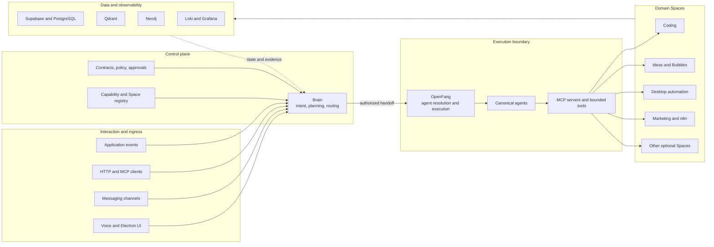
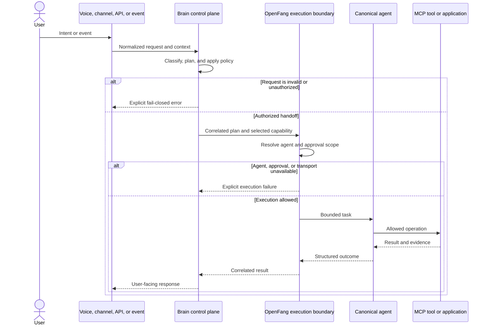
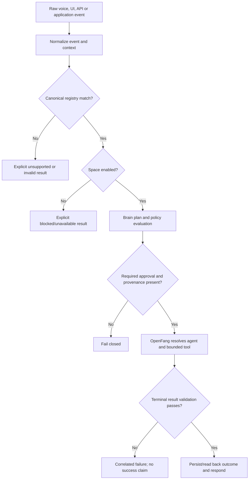
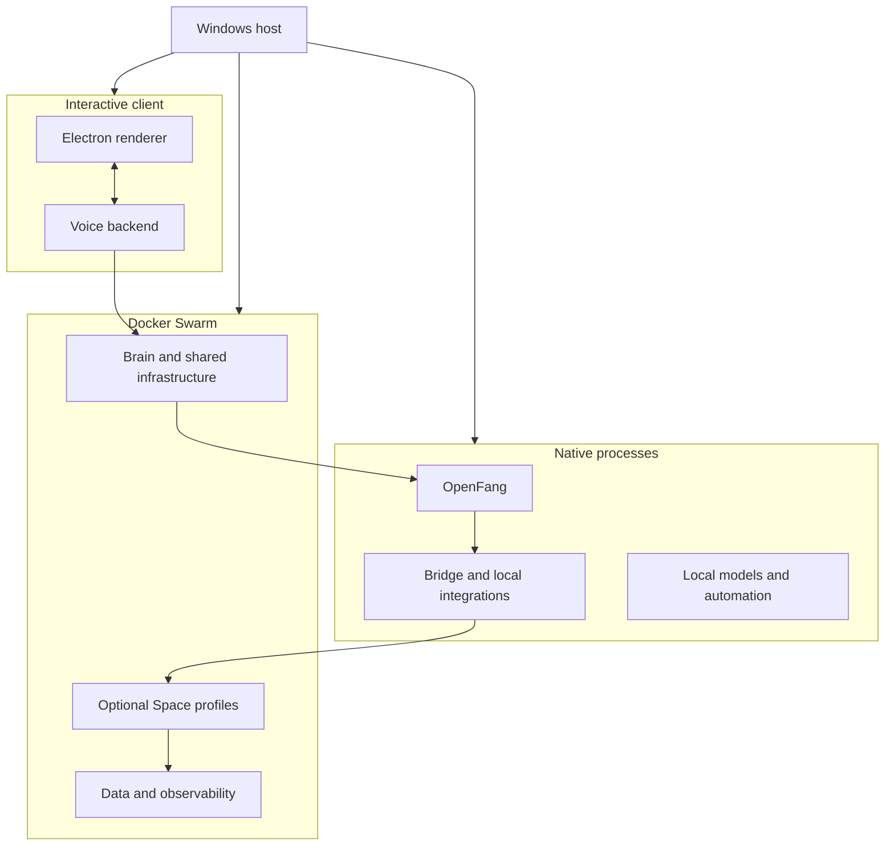
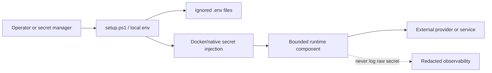
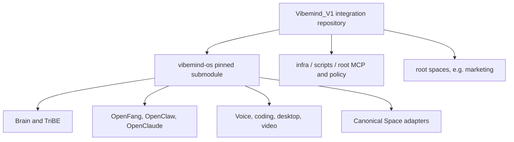

# VibeMind architecture

This document describes VibeMind's public system architecture from ingress to
durable outcome. It explains component responsibilities, authority boundaries,
data ownership, deployment shapes and failure behavior; it does not claim that
every optional service is enabled or currently reachable in a deployment.

For a standalone visual version, open [`architecture.html`](architecture.html).
For the complete 13-Space inventory, read [`SPACES.md`](SPACES.md). The
repository-first findings and known documentation drift are recorded in
[`DOCUMENTATION_AUDIT.md`](DOCUMENTATION_AUDIT.md).

## System context

VibeMind is an agentic workspace for turning voice, text, channel messages, and
application events into governed actions across specialized domain Spaces. It
separates deciding **what should happen** from authorizing and performing **what
does happen**.

The central design rule is:

> Brain is the control plane. OpenFang is the execution and approval boundary.
> Cognitive requests either follow that chain to a canonical agent/tool or fail
> closed. A runtime must not silently bypass OpenFang through a direct provider
> or application fallback.

Some historical or experimental modules still contain direct integration paths.
Their presence in the source tree is not evidence that they satisfy the current
authority contract.

## Architecture at a glance



## Canonical request lifecycle



## Component responsibilities

| Layer | Responsibility | Representative source |
| --- | --- | --- |
| Interaction | Voice, 3D UI, messaging, and programmatic ingress | `vibemind-os/voice/` |
| Brain | Intent classification, planning, capability selection, and lifecycle state | `vibemind-os/brain/` |
| Registry | Maps Spaces and events to canonical agents and allowed MCP scopes | `vibemind-os/config/space_agent_registry.yml` |
| Bridge | Translates Brain decisions into bounded OpenFang requests | `vibemind-os/bridge/` |
| OpenFang | Resolves canonical agents and owns execution/approval authority | `vibemind-os/openfang/` |
| MCP and tools | Expose bounded operations to agents | `mcp/`, `vibemind-os/examples/mcp-agents/` |
| Spaces | Domain applications such as coding, ideas, desktop, and marketing | `spaces/`, `vibemind-os/spaces/` |
| Data | Relational, vector, graph, queue, and artifact storage | `infra/swarm/vibemind-stack.yml` |
| Observability | Logs, dashboards, health evidence, and incident views | `infra/swarm/logging/` |

## Architectural ownership

VibeMind deliberately separates four kinds of ownership:

| Owner | Decides | Must not claim |
| --- | --- | --- |
| Ingress | Captures user input, device/channel context and a correlation boundary | That an action happened merely because it was requested |
| Brain control plane | Classifies intent, assembles context, plans and selects a canonical capability | Successful external execution without an OpenFang outcome |
| OpenFang execution plane | Resolves the canonical agent, enforces available approval/tool scope and executes a bounded task | Authority beyond the supplied plan/approval envelope |
| Space/application | Performs domain operations and owns terminal state readback | Global policy authority or success outside its domain store |

The registry connects these owners, but it is not a runtime. It is a versioned
contract describing which route is intended.

## Registry and routing model

`vibemind-os/config/space_agent_registry.yml` is the canonical mapping:

```text
event prefix -> canonical Space -> canonical agent -> MCP server/tool scope
             -> required parameters/provenance -> optional confirmation/result validation
```

At the audited revision it declares 13 Spaces and 135 event contracts. Twelve
Spaces are enabled; AgentFarm is explicitly disabled and blocked. Aliases such
as `autogen` and `shuttles` are ingress compatibility only. The canonical
identities remain `agentfarm` and `bubbles`.

The routing implementation under `vibemind-os/voice/python/swarm/routing/`
loads and applies these bindings. Generated inventories under
`vibemind-os/data/space_capabilities/` are useful secondary material but are
not authoritative when they disagree with the registry.



## Deployment model

VibeMind uses three cooperating deployment planes:

> **Proxmox is a no-model boundary.** No LLM, embedding, reranking, OCR/vision,
> speech, TTS, lip-sync, image, video, or other model may execute on the
> Proxmox host or any guest running on it. Proxmox is limited to data,
> application, workflow, gateway, and observability infrastructure. A service
> placed there may call an approved provider outside the Proxmox boundary, but
> it must never load model weights or fall back to local inference. The
> normative contract is
> [`proxmox-no-model-runtime-v1.md`](contracts/proxmox-no-model-runtime-v1.md).

1. **Docker Swarm** runs shared infrastructure and profile-selected services,
   including Brain, Qdrant, Supabase, optional Spaces, and observability.
2. **Native host processes** run components that require host integration or
   separate lifecycle control, such as OpenFang, local model services, bridges,
   and desktop automation.
3. **Electron and voice processes** provide the interactive UI and local device
   integration.

This inventory describes deployable components, not permission to place every
component on Proxmox. Model-bearing Swarm or native-host profiles remain outside
the Proxmox boundary.

The validated server launcher is `scripts/vibemind-start.ps1`; the interactive
launcher is `Vibemind.debug.ps1`. Both should be previewed with `-DryRun` before
starting services. Profile membership and enabled modules are configuration,
not proof that a service is live.



### Current deployment inventory

The root launcher always composes a core plane and can select additional
profiles. The following is derived from the checked-in stack and launcher, not
from a live cluster:

| Shape | Selection | Main components | Important qualifier |
| --- | --- | --- | --- |
| Core containers | always included | Brain core/API/loops, Qdrant, embeddings, Supabase services | Configuration does not prove database readiness or routed execution |
| Coding | `-Spaces "coding"` | Postgres, Redis, Gitea, code-server, egress proxy, API, worker, OpenClaude, frontend | Mutates code and repositories; terminal artifacts must be verified |
| Rowboat | stack profile `space-rowboat` | MongoDB, Redis, app, jobs and RAG workers | `rowboat-agents` is intentionally zero-replica |
| MiroFish | `-Spaces "mirofish"` | Neo4j and MiroFish | Both are configured zero-replica by default |
| n8n | `-Spaces "n8n"` | n8n and persistent data volume | Executions may have external side effects |
| Media | `-Spaces "media"` | nginx media publishing | Serving media is not generation |
| Logging | `-Spaces "logging"` | Loki, Promtail, Grafana | Observability data is evidence, not domain terminal state |
| Phase D | `-Spaces "core-phase-d"` | Brain learner and inference | Both are opt-in/zero-replica declarations |
| Native host | launcher phases | OpenFang, bridge, Ollama, la-fungus, Automation UI | Separate process lifecycle and health boundaries |
| Separate Compose | module-specific | Minibook, legacy module integrations | Not controlled by every Swarm Space selector |

Preview a deployment without starting it:

```powershell
.\scripts\vibemind-start.ps1 -Spaces "coding,n8n" -DryRun
```

The launcher profile name is an operational grouping, not necessarily a
one-to-one match with a canonical registry Space. For example, `media` and
`logging` are deployable profiles but are not canonical routing Spaces, while
Ideas and Research are canonical Spaces without dedicated profiles.

## Data and trust boundaries

- Secrets belong in ignored `.env` files, host secret stores, or Docker secrets;
  they must not be committed.
- Brain decisions and OpenFang execution results should carry correlation and
  lifecycle identifiers so an outcome can be traced to its plan.
- Application state belongs to the owning data service. Configuration, mocks,
  health endpoints, and historical logs are not substitutes for terminal state
  readback.
- Agent and tool scopes are allowlisted. Missing configuration, an unresolved
  canonical agent, an unavailable execution boundary, or malformed output must
  produce an explicit error.
- Optional external systems remain separate trust boundaries and require their
  own credentials, licenses, availability checks, and approval policies.

### Data ownership map

| Store/artifact | Primary use | Owning boundary | Verification expectation |
| --- | --- | --- | --- |
| Supabase/PostgreSQL | Bubbles, Ideas, projects, shared application records | Domain schema plus core data services | Read back the intended row/state with correlation |
| Coding Postgres/Redis | Coding jobs, queue and runtime coordination | Coding Space | Job terminal state plus produced artifact |
| Gitea and generated/artifact volumes | Repositories and code output | Coding Space | Commit/tree/artifact identity, not worker health |
| MongoDB/Redis | Rowboat application and work queue | Rowboat Space | Persisted document/job state |
| Qdrant | Brain and Rowboat vector collections | Collection-level owner on shared service | Query known ingested fixture and preserve collection scope |
| Neo4j | MiroFish graph and connected Brain reads | MiroFish/schema owner | Graph/job readback tied to the request |
| n8n data volume | Workflows, credentials metadata and executions | n8n Space | Execution record plus intended external result |
| Media volume | Published video artifacts | Video/media boundary | File identity, validation and publication receipt |
| Loki/Grafana | Logs and dashboards | Operations | Supporting evidence only; never the sole domain success proof |

### Secret flow

`setup.ps1` collects or reuses local environment values and writes ignored
configuration files. Docker deployments consume environment variables and
declared secrets. Documentation must name required variables but never include
real values. A leaked credential must be revoked and rotated; deleting the
latest file does not remove it from Git history.



## Failure model

The expected failure behavior is explicit and correlated:

| Failure | Required behavior |
| --- | --- |
| Unknown event or canonical Space | Reject as unsupported; do not guess another Space |
| Disabled Space | Return blocked/unavailable with the registry reason |
| Missing canonical agent or MCP tool | Fail closed; do not call a direct provider fallback |
| Missing approval/provenance | Stop before the side effect and request/return the missing authority |
| Transport timeout or malformed response | Return a bounded execution failure; retry only under the component policy |
| Tool reports success but terminal state is absent | Treat as unverified/failed, not successful |
| Partial multi-step outcome | Persist correlation and completed steps; expose partial state without overstating completion |
| External receipt absent | Do not claim a message, desktop action, publication or other external effect occurred |

## Observability and evidence

Every cross-boundary request should preserve a correlation identifier from
ingress through Brain plan, OpenFang handoff, agent/tool call and terminal
readback. Useful evidence includes lifecycle transitions, bounded tool names,
approval references, artifact identifiers and final state. Logs should be
structured and redacted.

Health endpoints answer whether a process can respond. Readiness adds whether
its dependencies are usable. Verified-live evidence additionally proves that a
representative request reached the intended terminal state. These are separate
checks and should remain separate in dashboards and release notes.

## Extension model

A new Space normally requires:

1. a stable Space identifier and event/capability contract;
2. a registry entry mapping it to a canonical agent;
3. an allowlisted MCP/tool scope;
4. an OpenFang handoff and explicit failure behavior;
5. focused tests for routing, forbidden fallbacks, and outcome evidence;
6. a deployment profile and health definition when runtime services are needed;
7. documentation of configuration, data ownership, and security boundaries.

The documentation definition of done is expanded in
[`DOCUMENTATION_AUDIT.md#documentation-acceptance-checklist`](DOCUMENTATION_AUDIT.md#documentation-acceptance-checklist).

## Repository and component topology

The root repository is an integration repository. `vibemind-os` is a pinned
Git submodule and contains further nested repositories for Brain/TriBE, coding,
OpenFang/OpenClaw, desktop automation, video, voice and other components. A
parent commit stores only each child commit ID; changing a nested repository
requires committing/publishing the child first and then updating the parent
pointer.



Always clone and update recursively. Review license and security policy at each
nested repository boundary before redistributing it.

## Status vocabulary

Architecture and operations documents should keep these evidence levels
separate:

| Status | Meaning |
| --- | --- |
| Static | The source or contract exists in the repository. |
| Configured | A deployment or registry references the component. |
| Historical | A previous run recorded evidence, which may now be stale. |
| Reachable | A transport endpoint answered a current probe. |
| Verified live | A current end-to-end run reached the intended terminal state and produced correlated evidence. |

Unless a document explicitly records fresh runtime evidence, this architecture
overview makes only static and configured claims.

## Further reading

- [`SPACES.md`](SPACES.md) — canonical catalog for all 13 Spaces
- [`DOCUMENTATION_AUDIT.md`](DOCUMENTATION_AUDIT.md) — coverage, drift and follow-up tasks
- [`infra/swarm/STARTUP_PROFILES.md`](../infra/swarm/STARTUP_PROFILES.md) — deployment profiles and service groups
- [`infra/swarm/vibemind-stack.yml`](../infra/swarm/vibemind-stack.yml) — Swarm source
- [`vibemind-os/config/space_agent_registry.yml`](../vibemind-os/config/space_agent_registry.yml) — Space/agent mapping
- [`vibemind-os/README.md`](../vibemind-os/README.md) — component repository overview
