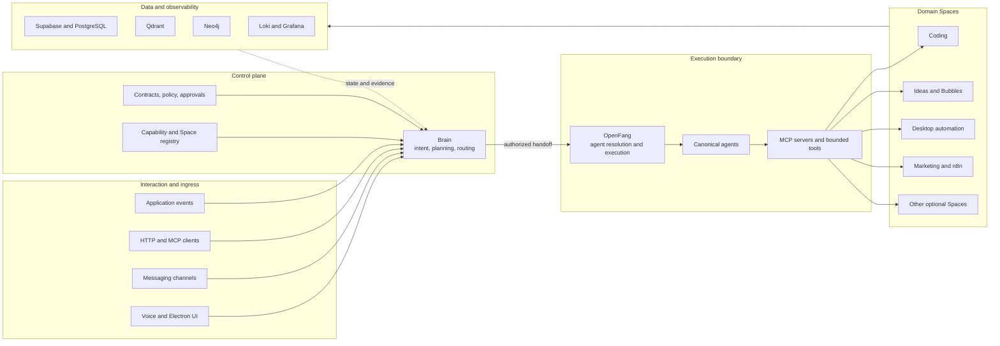
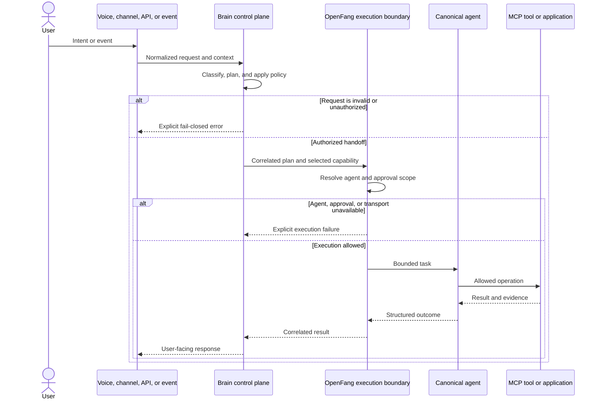
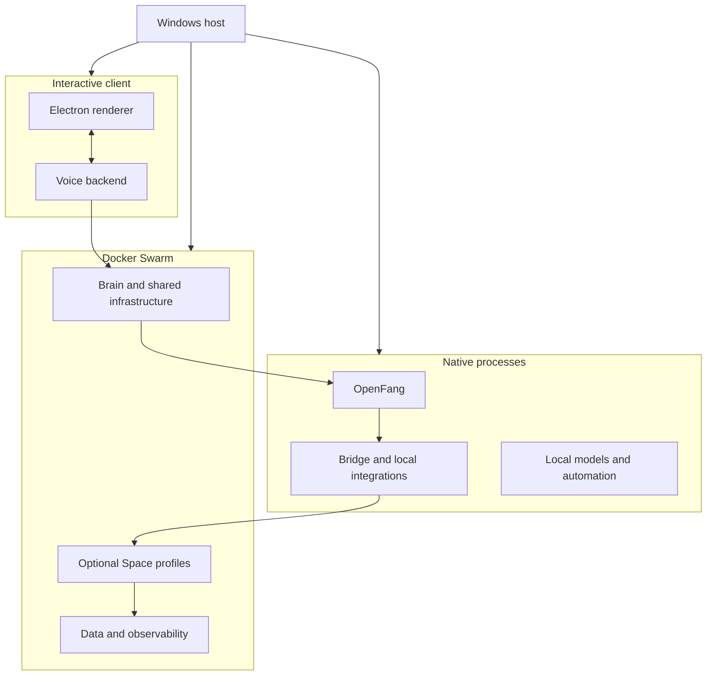

# VibeMind architecture

This document describes VibeMind's public, high-level architecture. It explains
component responsibilities and intended boundaries; it does not claim that
every optional service is enabled or currently reachable in a given deployment.

For a standalone visual version, open [`architecture.html`](architecture.html).

## System context

VibeMind is an agentic workspace for turning voice, text, channel messages, and
application events into governed actions across specialized domain Spaces. It
separates deciding **what should happen** from authorizing and performing **what
does happen**.

The central design rule is:

> Brain is the control plane. OpenFang is the execution and approval boundary.
> Cognitive requests either follow that chain to a canonical agent/tool or fail
> closed. A runtime must not silently bypass OpenFang through a direct provider
> or application fallback.

Some historical or experimental modules still contain direct integration paths.
Their presence in the source tree is not evidence that they satisfy the current
authority contract.

## Architecture at a glance

## Canonical request lifecycle

## Component responsibilities

| Layer | Responsibility | Representative source |
| --- | --- | --- |
| Interaction | Voice, 3D UI, messaging, and programmatic ingress | `vibemind-os/voice/` |
| Brain | Intent classification, planning, capability selection, and lifecycle state | `vibemind-os/brain/` |
| Registry | Maps Spaces and events to canonical agents and allowed MCP scopes | `vibemind-os/config/space_agent_registry.yml` |
| Bridge | Translates Brain decisions into bounded OpenFang requests | `vibemind-os/bridge/` |
| OpenFang | Resolves canonical agents and owns execution/approval authority | `vibemind-os/openfang/` |
| MCP and tools | Expose bounded operations to agents | `mcp/`, `vibemind-os/examples/mcp-agents/` |
| Spaces | Domain applications such as coding, ideas, desktop, and marketing | `spaces/`, `vibemind-os/spaces/` |
| Data | Relational, vector, graph, queue, and artifact storage | `infra/swarm/vibemind-stack.yml` |
| Observability | Logs, dashboards, health evidence, and incident views | `infra/swarm/logging/` |

## Deployment model

VibeMind uses three cooperating deployment planes:

1. **Docker Swarm** runs shared infrastructure and profile-selected services,
   including Brain, Qdrant, Supabase, optional Spaces, and observability.
2. **Native host processes** run components that require host integration or
   separate lifecycle control, such as OpenFang, local model services, bridges,
   and desktop automation.
3. **Electron and voice processes** provide the interactive UI and local device
   integration.

The validated server launcher is `scripts/vibemind-start.ps1`; the interactive
launcher is `Vibemind.debug.ps1`. Both should be previewed with `-DryRun` before
starting services. Profile membership and enabled modules are configuration,
not proof that a service is live.

## Data and trust boundaries

- Secrets belong in ignored `.env` files, host secret stores, or Docker secrets;
  they must not be committed.
- Brain decisions and OpenFang execution results should carry correlation and
  lifecycle identifiers so an outcome can be traced to its plan.
- Application state belongs to the owning data service. Configuration, mocks,
  health endpoints, and historical logs are not substitutes for terminal state
  readback.
- Agent and tool scopes are allowlisted. Missing configuration, an unresolved
  canonical agent, an unavailable execution boundary, or malformed output must
  produce an explicit error.
- Optional external systems remain separate trust boundaries and require their
  own credentials, licenses, availability checks, and approval policies.

## Extension model

A new Space normally requires:

1. a stable Space identifier and event/capability contract;
2. a registry entry mapping it to a canonical agent;
3. an allowlisted MCP/tool scope;
4. an OpenFang handoff and explicit failure behavior;
5. focused tests for routing, forbidden fallbacks, and outcome evidence;
6. a deployment profile and health definition when runtime services are needed;
7. documentation of configuration, data ownership, and security boundaries.

## Status vocabulary

Architecture and operations documents should keep these evidence levels
separate:

| Status | Meaning |
| --- | --- |
| Static | The source or contract exists in the repository. |
| Configured | A deployment or registry references the component. |
| Historical | A previous run recorded evidence, which may now be stale. |
| Reachable | A transport endpoint answered a current probe. |
| Verified live | A current end-to-end run reached the intended terminal state and produced correlated evidence. |

Unless a document explicitly records fresh runtime evidence, this architecture
overview makes only static and configured claims.

## Further reading

- [`infra/swarm/STARTUP_PROFILES.md`](../infra/swarm/STARTUP_PROFILES.md) — deployment profiles and service groups
- [`infra/swarm/vibemind-stack.yml`](../infra/swarm/vibemind-stack.yml) — Swarm source
- [`vibemind-os/config/space_agent_registry.yml`](../vibemind-os/config/space_agent_registry.yml) — Space/agent mapping
- [`vibemind-os/README.md`](../vibemind-os/README.md) — component repository overview
