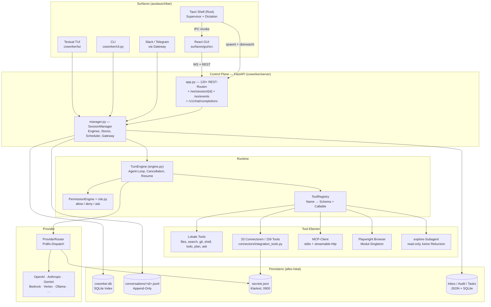
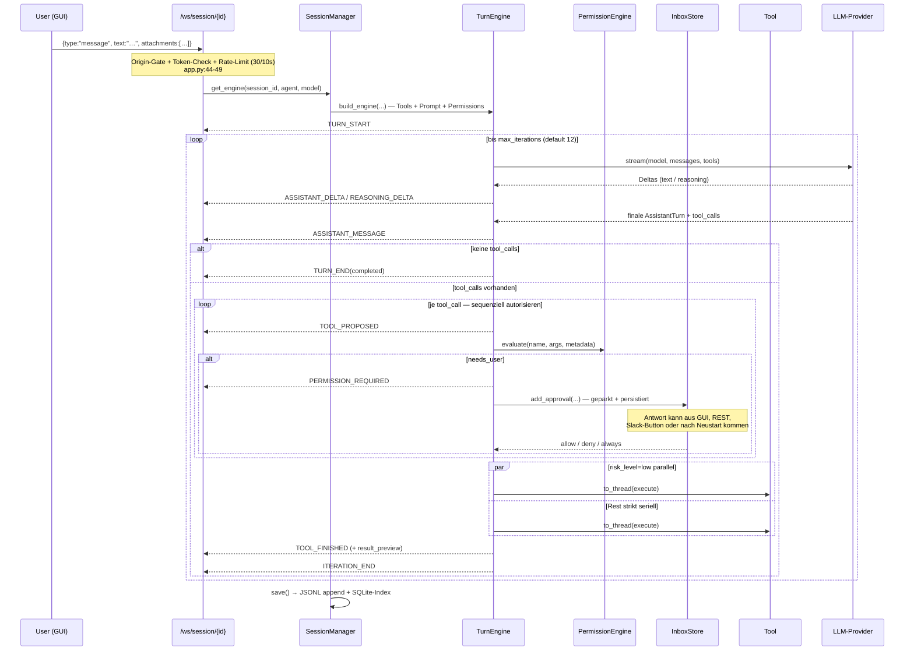
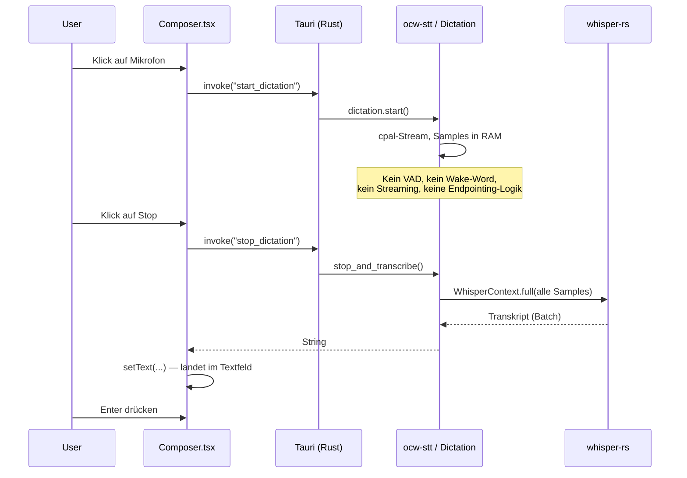

# 01 — Gesamtarchitektur

## 1.1 Die Grundentscheidung: Local-First Sidecar statt Client-Server

OpenWorker ist **kein** verteiltes System. Es ist ein **Ein-Prozess-Backend mit
mehreren Frontends**, das auf `127.0.0.1` lauscht. Diese eine Entscheidung erklärt
90 % aller übrigen Architekturentscheidungen.

**Warum die Entwickler das so gebaut haben** (belegt, nicht vermutet):

- `README.md:63`: „OpenWorker is local-first. Everything lives on your machine: the
  agent loop, your conversations, connector tokens, and model keys."
- Das Produktversprechen ist *Datenhoheit*: Der User bringt seinen eigenen API-Key,
  die Daten verlassen die Maschine nur über Modell + Connector, die er selbst wählt.
- Konsequenz: kein Multi-Tenancy, keine Auth-Domäne, keine horizontale Skalierung —
  und deshalb auch **keine** der Komplexität, die man dafür bräuchte.

**Trade-off, den sie damit gekauft haben:**

| Gewonnen | Bezahlt mit |
|---|---|
| Kein Server-Betrieb, kein Datenschutz-Thema, kein Billing | Keine Skalierung über einen Rechner hinaus |
| Direkter Zugriff auf Dateien/Shell/Desktop | Keine Isolation — Blast-Radius = User-Account ([08](08-security-risikoanalyse.md#r-01)) |
| Ein Prozess = ein Event-Loop = einfache Zustandsverwaltung | `SessionManager` wird zum 3.766-LOC-God-Object ([10](10-backend.md#101-die-manager-monolith-frage)) |
| Sofortiger Start, kein Deployment | Kein durable Workflow-Backend; Crash = Verlust laufender Turns außer an Prompt-Punkten |

---

## 1.2 Layer-Modell



### Verantwortlichkeiten pro Layer

| Layer | Verantwortung | Bewertung |
|---|---|---|
| **Surfaces** | Darstellung + Nutzerinteraktion. Kein Geschäftslogik-Anteil außer Stream-Gating. | Sauber getrennt. Die Event-Semantik (`coworker/events.py`) ist der Vertrag — 15 Event-Typen, mehr nicht. **Gut.** |
| **Control Plane** | Auth (Token), CORS/Origin-Gate, Routing, WebSocket-Bridging, Persistenz-Trigger. | `app.py` ist noch lesbar; `manager.py` ist ein God-Object mit ~150 Methoden. **Schwach.** |
| **Runtime** | Der eigentliche Agent-Loop, Berechtigungsentscheidung, Tool-Ausführung. | Der beste Teil des Repos. Klar, kommentiert, testbar, ohne Framework-Magie. **Sehr gut.** |
| **Tools** | Alle Seiteneffekte. | Heterogen: lokale Tools exzellent, Connectoren ein 4.892-LOC-Monolith. **Gemischt.** |
| **Provider** | Modellzugriff, Fähigkeits-Degradation (Vision/PDF). | Elegante Präfix-Routing-Lösung, sauberes Capability-Downgrade. **Gut.** |
| **Persistenz** | Sessions, Memory, Secrets, Audit, Tasks. | Fünf verschiedene Speicherformen ohne gemeinsame Abstraktion. **Schwach.** |

---

## 1.3 Request Flow — ein Nutzer-Turn von Anfang bis Ende



**Was hier architektonisch bemerkenswert ist:**

1. **Autorisierung und Ausführung sind zwei getrennte Phasen.** Erst werden *alle*
   Tool-Calls eines Turns autorisiert (sequenziell, weil interaktiv), dann ausgeführt
   (`engine.py:437-502`). Das verhindert, dass ein User mitten in einer parallelen
   Ausführung um Erlaubnis gefragt wird — ein UX-Detail mit Architekturwirkung.
2. **Approval ist out-of-band.** Die Engine kennt nur ein `Approver`-Callable
   (`engine.py:45`). Wo die Frage landet — Inline-Karte, Inbox, Slack-Button — entscheidet
   die Surface. Die Engine wartet nur.
3. **Jeder Prompt ist ein persistiertes Inbox-Item.** `app.py:1489-1520` — der
   Approver legt ein Item an, `persist_session()` schreibt die Historie auf Platte,
   *dann* wird gewartet. Deshalb überlebt ein wartender Turn den Prozess-Neustart.

---

## 1.4 Event Flow

Zwei WebSockets, klar getrennt:

| Socket | Zweck | Broadcast |
|---|---|---|
| `/ws/session/{id}` | Turn-Events *einer* Session, plus Steuerbefehle (message, stop, steer, set_mode, switch_model) | An alle Clients derselben Session (`manager.broadcast_session`) |
| `/ws/events` | Globale Ereignisse: neue Session, Inbox-Änderung, Automation-Lauf, Connector-Status | An alle verbundenen Clients (`manager.broadcast_event`) |

Der Event-Vertrag ist bewusst schmal — 15 Typen in `coworker/events.py:14-33`:

```
TURN_START · ASSISTANT_DELTA · REASONING_DELTA · ASSISTANT_MESSAGE
TOOL_PROPOSED · PERMISSION_REQUIRED · DIRECTORY_REQUESTED · QUESTION_REQUESTED
PLAN_PROPOSED · TOOL_STARTED · TOOL_FINISHED · ITERATION_END · TURN_END
ERROR · INTERRUPTED
```

**Bewertung:** Das ist ein guter, minimaler Vertrag — *aber es ist kein Event-Bus.*
Es gibt kein Publish/Subscribe zwischen Komponenten, kein Event-Log, keine
Wiederherstellbarkeit aus Events. Events sind reine **UI-Benachrichtigungen**;
der Zustand liegt woanders (in der Message-Liste). Für VibeMind, das laut Zielarchitektur
einen echten Event Bus braucht, ist das **nicht** übernehmbar — die *Event-Taxonomie*
dagegen schon (siehe [ADR-0004](adr/ADR-0004-event-taxonomie.md)).

---

## 1.5 Audio Flow



**Das ist der komplette Audio-Flow.** Es gibt keinen Rückweg: **kein TTS**, keine
Sprachausgabe, keine Audio-Antwort. Verifiziert durch Volltextsuche über alle
`.py`/`.ts`/`.tsx`/`.rs`-Dateien nach `tts`, `speechSynthesis`, `wake_word`,
`porcupine`, `barge` — **null Treffer**.

Details und Konsequenzen: [05 — Voice Pipeline](05-voice-pipeline.md).

---

## 1.6 Tool Flow

```mermaid
graph LR
    subgraph BUILD["Build-Zeit — agent.py:build_engine()"]
        A["Agent/Persona<br/>family, messaging, connectors"] --> CAT["catalog.expand()<br/>Capability-IDs → Callables"]
        CAT --> R["ToolRegistry"]
        MCPX["MCP-Tools<br/>(vom Manager vorbereitet)"] --> R
        CX["Connector-Tools<br/>gefiltert nach enabled"] --> R
        WEB["web_search / web_fetch"] --> R
        SK["load_skill"] --> R
        SCH["Scheduling / Self-Wake<br/>(nur family=knowledge)"] --> R
        EXP["explore<br/>(nur family=code)"] --> R
    end

    subgraph CALL["Call-Zeit"]
        R -->|schemas()| LLM["Modell sieht<br/>alle Schemas"]
        LLM -->|tool_call| CLASSIFY["risk.classify()"]
        CLASSIFY --> DEC["PermissionEngine.evaluate()"]
        DEC -->|allow| EXEC["registry.execute()<br/>in to_thread"]
        DEC -->|needs_user| ASK["Inbox-Item + await"]
        DEC -->|deny| ERR["tool-error message"]
    end
```

**Die zentrale Schwäche dieses Flows:** Alle Tools landen in **einer flachen Registry**
und **alle Schemas** gehen in **jeden** Modellaufruf (`engine.py:393`:
`tools = self.registry.schemas() or None`). Bei aktivierten Connectoren + MCP-Servern
sind das schnell 60–150 Schemas pro Request. Es gibt **keine** Tool-Selektion,
kein Retrieval über Tools, keine Namespaces. Das ist der teuerste und riskanteste
Designfehler des Systems — siehe [04](04-tool-system.md#45-die-flat-registry-falle)
und [11](11-performance.md#b-02).

---

## 1.7 Datenfluss der Persistenz

```mermaid
graph TB
    ENG["TurnEngine.messages<br/>(In-Memory, kanonisch OpenAI-Shape)"]
    ENG -->|_outbound_messages()<br/>Sidecars gestrippt| PROV["Provider"]
    ENG -->|manager.save() nach jedem Turn| JSONL["conversations/&lt;id&gt;.jsonl<br/>append-only"]
    ENG -->|persist_session() bei jedem Prompt| JSONL
    JSONL --> IDX["coworker.db<br/>sessions(id, title, project, n_msgs, roots, grants)"]
    IDX -->|Reload| ENG
```

**Elegante Idee:** Die Nachrichtenliste ist die *einzige* Wahrheit und immer im
kanonischen OpenAI-Format. Provider konvertieren pro Aufruf. Deshalb funktioniert
Modellwechsel mitten in der Session (`engine.py:180-207`) — es ist ein Feldschreibvorgang.

**Sidecar-Muster (sehr sauber, `engine.py:878-982`):** Anzeigemetadaten reisen als
Zusatzfelder auf der Nachricht mit (`source`, `_display`, `ts`, `reasoning`,
provider-private `_gemini`) und werden vor jedem Provider-Call abgestreift.
Das `_display`-Feld ist ein bemerkenswertes Sicherheitsdetail: es transportiert
z. B. „wie viele Gmail-Treffer haben die Privacy-Filter versteckt" an die UI,
**ohne dass das Modell diese Zahl je sieht** — sonst könnte es darum herumprobieren.

**Fehlend:** kein Schema-Versioning der JSONL, keine Migrationen, keine Kompaktierung.

---

## 1.8 Was die Architektur *nicht* enthält

Explizit verifiziert (Volltextsuche + Codelektüre), damit für VibeMind klar ist,
was **fehlt** und selbst gebaut werden muss:

| Fehlt | Belegt durch |
|---|---|
| Planner / Task-Zerlegung | Kein Modul; `tools/plan.py` ist nur `propose_plan` |
| Multi-Agent-Koordination | Nur `explore` (read-only, keine Rekursion), `tools/subagent.py:11` |
| Worker Pool / Queue | Keine; Tools laufen in `asyncio.to_thread` (Default-Executor) |
| Workflow-Engine / DAG | Keine; nur Cron-Scheduler (`automation/scheduler.py`) |
| Durable Execution (Temporal-artig) | Nur „Resume ab Prompt-Punkt" (`engine.py:250-292`) |
| Event Sourcing / CQRS | Nein — Events sind reine UI-Notifikationen |
| Vektorspeicher / Embeddings | Keine Zeile; Memory ist SQLite-Volltext ohne Index |
| Kontext-Kompaktierung | Keine; Historie wächst unbegrenzt |
| Sandbox / Container-Isolation | Nur `LocalExecutor` |
| TTS / Wake-Word / Barge-in | Null Treffer im gesamten Repo |
| Observability (Metriken/Tracing) | Nur `audit.py` (Tool-Entscheidungen), kein OTel |
| Rate-Limit / Retry gegen Provider | Nur `_param_fix_retry` für Parameterfehler |

---

**Weiter:** [02 — Repositorystruktur](02-repositorystruktur.md)
