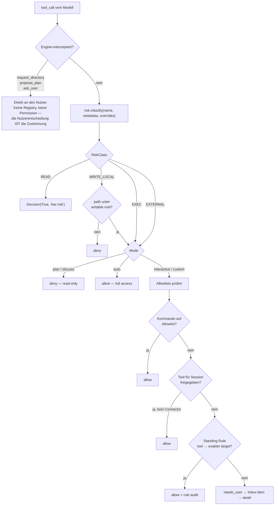

# 04 — Tool-System

---

## 4.1 Registrierung: eine flache Map, drei Wege hinein

`coworker/tools/registry.py` (72 LOC) ist die gesamte Registry:

```python
@dataclass
class ToolSpec:
    name: str
    schema: dict          # OpenAI-Function-Schema
    func: Callable
    metadata: Any         # aisuite ToolMetadata | None

class ToolRegistry:
    _tools: dict[str, ToolSpec]
```

Schema-Auflösung in Prioritätsreihenfolge (`registry.py:42-44`):
1. explizites `schema=`-Argument,
2. `func.__coworker_schema__` (Attribut),
3. Ableitung aus Docstring + Type-Hints via `aisuite.utils.tools.Tools`.

**Die drei Registrierungswege:**

| Weg | Für | Mechanismus |
|---|---|---|
| Docstring-Ableitung | Lokale Python-Tools | `@ai.tool` + Google-Style-Docstring → Schema automatisch |
| `__coworker_schema__` | Tools, deren Signatur nicht sauber ableitbar ist (`run_shell`, alle Connector- und Browser-Tools) | Handgeschriebenes Schema als Funktionsattribut |
| MCP | Externe Server | `inputSchema` aus dem MCP-Manifest 1:1 übernommen (`mcp/tools.py:34-43`) |

**Bewertung:** Minimal und ehrlich. Aber:

- **`register()` überschreibt kommentarlos** (`registry.py:45-46`). Zwei Tools gleichen
  Namens → das zweite gewinnt, ohne Warnung. Kombiniert mit dem 64-Zeichen-Abschnitt
  bei MCP-Namen (`mcp/tools.py:29-31`) ist das ein realer Kollisionspfad.
- **Keine Namespaces.** Alles lebt in einem globalen Namensraum.
- **Keine Versionierung**, kein Deprecation-Pfad, kein Health-Check pro Tool.

---

## 4.2 Auffindung: gar nicht

`engine.py:393` — `tools = self.registry.schemas()`. **Alle** Schemas, **jeder** Request.

Es gibt keine:
- Suche über Tools,
- Kategorisierung im Prompt,
- Lazy-Ladung nach Bedarf,
- Priorisierung nach Persona-Intent,
- Deaktivierung nach Nichtnutzung.

Die Auswahl trifft das Modell aus der vollständigen Liste. Bei ≤20 Tools funktioniert
das; bei 150 nicht.

**Bemerkenswert:** Für *Skills* wurde Progressive Disclosure implementiert
(`skills/base.py:6-8`: nur Katalog im Kontext, Rumpf per `load_skill`). Für *Tools* nicht.
Die Lösung liegt im selben Repo, wurde aber nicht übertragen.

---

## 4.3 Aufruf und Berechtigung



### Die Risikoklassifikation

`coworker/risk.py` — 58 Zeilen, vier Klassen:

```python
READ         # keine Seiteneffekte — immer erlaubt
WRITE_LOCAL  # verändert den Workspace — pfad-gescoped + mode-gated
EXEC         # führt Kommandos aus — mode-gated
EXTERNAL     # Seiteneffekte außerhalb der Maschine — der Unattended-Inbox-Hook
```

Auflösung (`risk.py:39-53`): **User-Override → Namenstabelle → aisuite-Metadaten
(`requires_approval` → EXTERNAL) → sonst READ**.

**Das ist ein sehr gutes, kleines Modell** und der Kern dessen, was VibeMind übernehmen
sollte ([ADR-0002](adr/ADR-0002-risk-klassifikation.md)). Insbesondere die Trennung
`WRITE_LOCAL` vs. `EXTERNAL` ist richtig: lokale Schreibvorgänge sind reversibel,
externe Sends nicht — und nur letztere brauchen den Inbox-Pfad im unbeaufsichtigten Betrieb.

**Aber der Default ist gefährlich:** `else: return RiskClass.READ`. Ein Tool ohne
Metadaten gilt als harmlos und läuft **ohne jede Prüfung**. Bei MCP wird das durch
`requires_approval` aus der Server-Config abgefangen — aber wer ein Tool per
`registry.register(func)` ohne Metadaten hinzufügt, hat ein ungeprüftes Tool.
**Fail-open statt fail-closed.** → [08 R-06](08-security-risikoanalyse.md#r-06).

### Die Shell-Allowlist — ein gut reparierter Bug

`permissions.py:216-238`. Der Kommentar ist die Erklärung:

> „An allowlist entry auto-runs a command **WITHOUT** approval, so prefix matching is
> unsafe: `git status` would auto-approve `git status && rm -rf ~`."

Die Lösung: (1) jedes Kommando mit Shell-Metazeichen (`;`, `&`, `|`, `>`, `<`,
`` ` ``, `$(`, `(`, `\n`, `\r`) ist **grundsätzlich** von der Allowlist ausgeschlossen;
(2) danach `shlex.split` und Token-für-Token-Präfixvergleich, damit `git status`
zwar `git status -s` erlaubt, aber nie `git statusfoo` oder ein nacktes `git`.

Das ist die richtige Lösung, sauber implementiert und getestet
(`tests/test_tools_permissions.py`). **Direkt übernehmbar.**

---

## 4.4 Die vier Tool-Ebenen im Detail

### (a) Lokale Tools

Über `catalog.py` als **Capabilities** gebündelt: `code_files`, `files`, `search`,
`shell`, `todo`, `git`. Eine Capability deklariert `requires` (Kontextvoraussetzungen:
`workspace`, `executor`, `todo`) und `risk`. `expand(ids, context)` überspringt
Capabilities, deren Voraussetzungen fehlen.

Der Katalog ist **explizit geschlossen** (`catalog.py:11-13`). Breite kommt aus MCP,
nicht aus Third-Party-Capabilities. Konsistente Produktentscheidung.

### (b) Connectoren

33 Connectoren, 159 Tools (gezählt über `TOOL_DEFS` in `connectors/tool_defs.py`):

```
browser 11 · asana 13 · jira 11 · monday 9 · github 8 · clickup 8 · outlook 7
close 6 · hubspot 6 · email 5 · google_calendar 5 · linear 4 · gitlab 4 · notion 4
attio 4 · quickbooks 4 · figma 4 · docusign 4 · canva 4 · gmail 3 · confluence 3
zendesk 3 · discord 3 · stripe 3 · dropbox 3 · box 3 · apollo 3 · hunter 3
google_drive 3 · whatsapp 2 · posthog 2 · mixpanel 2 · amplitude 2
```

Dreistufige Freigabe:
1. Connector verbunden (`connected`) — Credential vorhanden,
2. Connector aktiviert (`enabled`) — globaler Schalter,
3. Tool aktiviert (`tool.enabled`) — pro Tool,
4. **plus** optionaler Session-Filter (`connector_filter`, `agent.py:195-196`) —
   die Per-Session-Verbindungshierarchie.

Nur die Schnittmenge erzeugt Tools. Das ist granular und richtig.

**Bewertung:** Datenmodell A, Implementierung D (4.892-LOC-Monolith, keine
Plugin-Grenze). Details in [02](02-repositorystruktur.md#coworkerconnectors--der-problembereich).

### (c) MCP

`stdio` und `streamable-http`, mit OAuth-Unterstützung für HTTP-Server
(`mcp/oauth.py`). Konfiguration global unter `state_dir()`.

**Sicherheitsdetail, das ich lobenswert finde** (`mcp/client.py:44-51`):
`ensure(server, interactive=False)` als Default. Ein Server, der eine neue
Autorisierung verlangt, wirft `InteractiveAuthRequired`, **statt ungefragt den Browser
des Users zu kapern**. Nur explizite Connect-Aktionen setzen `interactive=True`.
Gespeicherte Tokens und Silent-Refresh funktionieren weiterhin. Das ist genau die
richtige Trennung.

**Lücken:**
- Nur Tools — keine Resources, keine Prompts, kein Sampling.
- Ein Risk-Level (`medium`) für alle Tools eines Servers, unabhängig davon, ob das Tool
  liest oder schreibt.
- Kein Server-Health-Monitoring, kein Reconnect nach Verbindungsabbruch — bei
  Verbindungsverlust wird die Connection einfach aus `_conns` entfernt
  (`client.py:138-140`), der nächste Call schlägt fehl.
- **Kein MCP-Server-Modus.** OpenWorker ist Client, nicht Server — es kann seine
  eigenen Fähigkeiten nicht per MCP anbieten.

### (d) Browser (Playwright)

11 Tools, `connectors/browser_automation.py`. Details in
[07 — Desktop Automation](07-desktop-automation.md).

**Architektonischer Defekt hier festhalten:** `_BROWSER = _BrowserController()` ist ein
**Modul-Singleton** (`browser_automation.py:223`). **Eine** Browser-Instanz für den
gesamten Prozess, also für **alle** Sessions. Zwei parallel arbeitende Sessions teilen
sich Seite, Cookies und Login-Zustand. Serialisiert über einen
`ThreadPoolExecutor(max_workers=1)` — was Korruption verhindert, aber Sessions
gegenseitig blockieren lässt.

---

## 4.5 Die Flat-Registry-Falle

Fassen wir die vier Ebenen zusammen: Sie münden **alle** in dieselbe flache
`dict[str, ToolSpec]` und werden **alle** bei jedem Request an das Modell geschickt.

**Konsequenzen:**

| Problem | Wirkung |
|---|---|
| Token-Kosten | 20–30 k Token/Request nur für Schemas ([11 B-02](11-performance.md#b-02)) |
| Auswahlqualität | Modelle wählen bei >50 Tools messbar schlechter |
| Namenskollisionen | Stilles Überschreiben, kein Fehler |
| Kein Least-Privilege pro Task | Ein Recherche-Turn sieht dieselben 159 Tools wie ein Schreib-Turn |
| Prompt-Injection-Angriffsfläche | Jedes Tool ist immer erreichbar, auch nach Konsum fremder Inhalte |

**Für VibeMind ist das die wichtigste Nicht-Übernahme-Entscheidung.**
Bei 446 Intents über 19 Kategorien (`intent_validation/00_MASTER.md`) ist eine flache
Registry ausgeschlossen. VibeMind braucht:

- **Namespaces** (`space:tool`) mit Kollisionsfehler statt Überschreiben,
- **Tool-Retrieval** — semantische Auswahl der Top-k Tools pro Turn,
- **Capability-Scoping pro Agent-Rolle** (der Planner sieht andere Tools als der Worker),
- **Progressive Disclosure auf Tool-Ebene** (Kategorie-Katalog → `load_toolset(kategorie)`).

→ [ADR-0007](adr/ADR-0007-tool-registry-namespaces.md).

---

## 4.6 Kann man neue Tool-Typen ergänzen?

| Neuer Typ | Aufwand | Wie |
|---|---|---|
| Neues lokales Tool | **Trivial** | Funktion + `@ai.tool(metadata=…)`, in einen Capability-Builder eintragen |
| Neuer Capability-Bundle | **Klein** | Eintrag in `catalog.py` + `requires`/`risk` |
| Neuer MCP-Server | **Trivial, ohne Code** | REST `POST /v1/mcp` oder UI |
| Neuer Connector | **Groß** | Descriptor + ToolDefs + Implementierung in `integration_tools.py` + ggf. OAuth-Broker-Mapping + GUI-Detailkomponente. Nur upstream möglich. |
| Neue *Transportart* (z. B. gRPC-Tools, HTTP-Tool-Server) | **Mittel** | Es gibt keine Abstraktion dafür. Man müsste, wie MCP es tut, Callables mit `__coworker_schema__` + `__aisuite_tool_metadata__` erzeugen und registrieren. Das Muster ist da, die Abstraktion nicht. |
| Neue *Risikoklasse* | **Klein** | Enum + `is_consequential` + Behandlung in `PermissionEngine.evaluate` |

**Bewertung:** Die Erweiterbarkeit ist **asymmetrisch** — nach *außen* (MCP) exzellent,
nach *innen* (Connector, Capability) geschlossen. Das ist gewollt, aber es bedeutet:
Wer OpenWorker forkt, um Connectoren zu ergänzen, kämpft gegen die Architektur.
Wer MCP-Server anbindet, hat es leicht.

**Für VibeMind heißt das:** Der MCP-Pfad ist der einzige, den man ohne Fork nutzen
kann — und VibeMind hat bereits eigene MCP-Server (`mcp/docker/`, `tools/mcp_sync/`).
Der Connector-Bestand ist **nicht** ohne Fork nutzbar.

---

## 4.7 Bewertungsmatrix

| Aspekt | Note | |
|---|---|---|
| Registry-Mechanik | B+ | Minimal, drei saubere Wege hinein — aber flach, ohne Namespaces |
| Risikoklassifikation | **A** | Klein, richtig, erweiterbar — Fail-open-Default abziehen |
| Permission-Engine | **A** | Mode × Risk × Pfad × Allowlist × Standing Rule, gut getestet |
| Shell-Allowlist-Härtung | **A** | Metazeichen-Ausschluss + Token-Präfix |
| MCP-Client | B+ | Async-Lifecycle korrekt gelöst; nur Tools, ein Risk-Level |
| Connector-Datenmodell | **A** | Descriptor + ToolDef + `target_arg` |
| Connector-Implementierung | D | 4.892-LOC-Monolith, geschlossen |
| Browser-Tools | C | Modul-Singleton, keine Session-Isolation |
| Tool-Auffindung / -Selektion | **E** | Existiert nicht |
| Erweiterbarkeit nach außen (MCP) | **A** | |
| Erweiterbarkeit nach innen | D | Bewusst geschlossen |

---

**Weiter:** [05 — Voice Pipeline](05-voice-pipeline.md)
