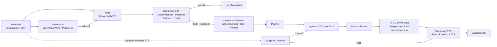

# 05 — Voice Pipeline

> **Leitfrage:** Kann diese Pipeline als Grundlage für ein Voice-first OS dienen?
> **Antwort: Nein.** Begründung unten, Zeile für Zeile.

---

## 5.1 Was tatsächlich existiert

Die vollständige Sprachfunktionalität von OpenWorker besteht aus:

| Komponente | Datei | Umfang |
|---|---|---|
| Rust-Crate `ocw-stt` | `stt/src/lib.rs` | 666 LOC |
| Tauri-Commands | `surfaces/gui/src-tauri/src/lib.rs:279-470` | ~190 LOC |
| GUI-Integration | `surfaces/gui/src/components/Composer.tsx` | ~120 LOC verteilt |
| Settings-UI | `SettingsView.tsx` (Voice-Input-Abschnitt) | — |

Das war's. **Insgesamt unter 1.000 Zeilen für „Voice".**

### Der Ablauf

```
Klick Mikrofon
  → Tauri invoke("start_dictation")
  → cpal öffnet Default-Input-Device
  → f32-Samples werden in einen Vec<f32> im RAM geschrieben
  → [User spricht — beliebig lange, kein Timeout, kein VAD]
Klick Stop
  → Tauri invoke("stop_dictation")
  → resample auf 16 kHz
  → whisper_rs: WhisperContext.full(ALLE Samples auf einmal)
  → String zurück an die GUI
  → setText() im Composer-Textfeld
  → User drückt Enter
```

---

## 5.2 Was fehlt — verifiziert, nicht vermutet

Volltextsuche über **alle** `.py`, `.ts`, `.tsx`, `.rs`-Dateien des Repos nach:
`tts`, `TextToSpeech`, `speechSynthesis`, `wake_word`, `wakeword`, `porcupine`, `barge`
→ **null Treffer.**

| Fähigkeit | Status | Konsequenz für Voice-first |
|---|---|---|
| **TTS / Sprachausgabe** | ❌ existiert nicht | Es gibt keinen Rückkanal. Das System kann nicht sprechen. |
| **Wake-Word** | ❌ | Jede Interaktion braucht einen Mausklick. Das ist per Definition nicht Voice-first. |
| **Streaming-STT** | ❌ Batch nach Stop | Latenz = Sprechdauer + Transkriptionszeit. Kein partielles Feedback. |
| **VAD / Endpointing** | ❌ | Der User muss den Endpunkt manuell setzen. |
| **Barge-in / Interruption** | ❌ | Ohne TTS gibt es nichts zu unterbrechen. |
| **Turn-Taking / Duplex** | ❌ | Strikt halbduplex, manuell getaktet. |
| **Mehrsprachigkeit** | ❌ `ggml-base.en.bin` | **Englisch only.** Für VibeMind (deutschsprachig) unbrauchbar. |
| **Diarisierung / Multi-Speaker** | ❌ | — |
| **Audio-Ausgabe-Routing** | ❌ | Kein Ausgabegerät wird je geöffnet. |
| **Voice-Intent-Erkennung** | ❌ | Der Text geht unverändert an das LLM. |
| **Browser-Unterstützung** | ❌ nur Tauri | `Composer.tsx:289`: `if (!isTauri() ...) return;` — im Browser-Dev-Modus gibt es keine Sprache. |

---

## 5.3 Was handwerklich gut gemacht ist

Fairerweise: Die Crate ist für ihren Zweck sauber gebaut.

- **Bewusst hostfrei** (`stt/src/lib.rs:3-5`): „This crate deliberately has no Tauri, UI,
  clipboard, or global-shortcut dependency. Hosts own their own UX and permission flows."
  Die Trennung ist korrekt — man könnte sie in einem anderen Host wiederverwenden.
- **Atomarer, verifizierter Modell-Download** (`lib.rs:212-228`): Download nach
  `.bin.part`, SHA-256-Prüfung gegen eine fest verdrahtete Konstante
  (`a03779c86df3…`), erst dann `rename`. Ein abgebrochener Download ersetzt nie ein
  verifiziertes Modell. Ein `.verified`-Marker und ein separater `.ready`-Marker
  (Testlauf bestanden) trennen „installiert" von „funktioniert".
- **Per-Read-Timeout statt Gesamt-Timeout** (`lib.rs:190-195`) mit expliziter Begründung:
  ein 142-MB-Transfer dauert legitim Minuten, aber eine tote Verbindung muss auffallen —
  und das Cancel-Flag wird nur zwischen Reads geprüft, ein blockierender Read würde
  Cancel unresponsiv machen. Durchdacht.
- **CPAL-Stream auf dediziertem Owner-Thread** (`lib.rs:88-90`), weil er `!Send` ist —
  statt ihn unsafe durch Tauris `Send + Sync`-State zu zwingen. Korrekt.
- **Audio wird nie persistiert** (`lib.rs:60-63`): nur im RAM für die Dauer der Session.
  Datenschutzseitig sauber.
- **Ein Live-Handle auf den Sample-Puffer** (`lib.rs:69-71`) erlaubt der UI ein
  Pegel-Meter — im Composer als animierte Wellenform umgesetzt (`Composer.tsx:441-460`).

**Note: B+ für die Crate. Note: E für den Anspruch „Voice-first".**

---

## 5.4 Latenzanalyse

Die relevante Frage für ein Voice-Interface ist die Zeit von „User hört auf zu sprechen"
bis „System reagiert hörbar".

| Phase | OpenWorker | Zielwert Voice-first |
|---|---|---|
| Endpoint-Erkennung | **manuell (Klick)** | 200–500 ms (VAD) |
| STT | Batch über die *gesamte* Äußerung, nach Stop.<br/>Whisper base auf CPU: grob 0,3–1× Realzeit | Streaming, 100–300 ms nach Endpoint |
| Intent/Routing | — (Text geht direkt ins LLM) | 50–200 ms |
| LLM-Time-to-first-token | 0,5–3 s je Provider | < 500 ms |
| TTS-Time-to-first-audio | **∞ (existiert nicht)** | 150–400 ms |
| **Gesamt bis erste hörbare Reaktion** | **nicht messbar — es gibt keine** | **< 1,2 s** |

Selbst wenn man TTS ergänzte: Die **Architektur** ist auf Batch ausgelegt. Der
Sample-Puffer wird komplett gefüllt, dann komplett transkribiert. Ein Streaming-Pfad
wäre kein Zusatz, sondern eine Neuimplementierung — anderes Modell (whisper-streaming /
Distil-Whisper / Parakeet), andere Pufferstrategie, VAD, Endpointing, Partial-Results,
Confirmation-Handling.

---

## 5.5 Was für VibeMind trotzdem relevant ist

Drei Dinge, die *nicht* aus der Voice-Pipeline stammen, aber Voice-first-Probleme lösen:

### (a) Der Cancellation-Mechanismus **ist** Barge-in

`engine.py:120-148` bricht aus jedem Zustand ab — mitten im Stream, mitten im Tool,
im Warten auf Approval. **Barge-in ist nichts anderes:** Der User spricht, während
das System redet → sofortiger Abbruch des laufenden Turns, mit garantiert konsistenter
Historie (jeder ausstehende `tool_call` bekommt eine Antwort). VibeMind braucht genau
diese Invariante, sobald TTS läuft.

### (b) Das Stream-Gating ist das TTS-Commit-Problem

`streamGate.ts` löst: „Wann darf gestreamter Text als *Antwort* dargestellt werden,
und wann ist er nur Narration?" — Schwelle 40 Wörter, mit dem Kommentar
„people can wait 1-2 seconds longer".

Für TTS ist das dieselbe Frage in verschärfter Form: **Gesprochenes ist nicht
zurücknehmbar.** Man kann nicht anfangen, einen Satz vorzulesen, und dann feststellen,
dass es nur Narration vor einem Tool-Call war. VibeMind braucht ein
Commit-Point-Konzept für TTS — die Heuristik hier ist ein brauchbarer Startpunkt,
aber sie muss für Audio strenger und semantischer werden (Satzgrenzen, Sprechakte).

### (c) Das Modell-Provisioning-Muster

Download → SHA-256-Verifikation → `.verified`-Marker → Testlauf → `.ready`-Marker.
Genau das braucht VibeMind für lokale STT-/TTS-/Embedding-Modelle. Direkt adaptierbar.

---

## 5.6 Was VibeMind stattdessen bauen muss



**Nichts** in diesem Diagramm außer dem Cancel-Pfad und dem Commit-Gate lässt sich aus
OpenWorker übernehmen.

**Wichtig für VibeMind-Kontext:** `infra/swarm/STARTUP_PROFILES.md` vermerkt für das
eigene Voice-Modul bereits „**native STT/TTS unvollständig**". Das heißt: VibeMind hat
hier eine offene Baustelle, und OpenWorker schließt sie **nicht** — nicht einmal
teilweise. Die einzige Übernahme wäre `ocw-stt` als *Push-to-Talk-Diktat für
Textfelder*, was VibeMinds Anspruch unterschreitet.

---

## 5.7 Entscheidung

| Komponente | Entscheidung | Begründung |
|---|---|---|
| `ocw-stt` (Whisper-Crate) | **Nicht übernehmen** | Batch, Englisch-only, Push-to-Talk. Falsche Architektur für Streaming. |
| Modell-Provisioning-Muster | **Übernehmen (Muster, nicht Code)** | Download+SHA+Marker ist genau richtig für lokale Modelle. |
| Tauri-Dictation-Commands | **Nicht übernehmen** | An Tauri gebunden; VibeMind nutzt Electron. |
| Stream-Gate-Heuristik | **Übernehmen und erweitern** | Konzeptioneller Startpunkt für das TTS-Commit-Gate. |
| Cancellation-Invarianten | **Übernehmen** | = Barge-in-Fundament. Siehe [ADR-0003](adr/ADR-0003-cancellation-invarianten.md). |
| Voice-Pipeline gesamt | **Neu entwickeln** | Siehe [ADR-0010](adr/ADR-0010-voice-pipeline-neuentwicklung.md). |

---

**Weiter:** [06 — Memory](06-memory.md)
