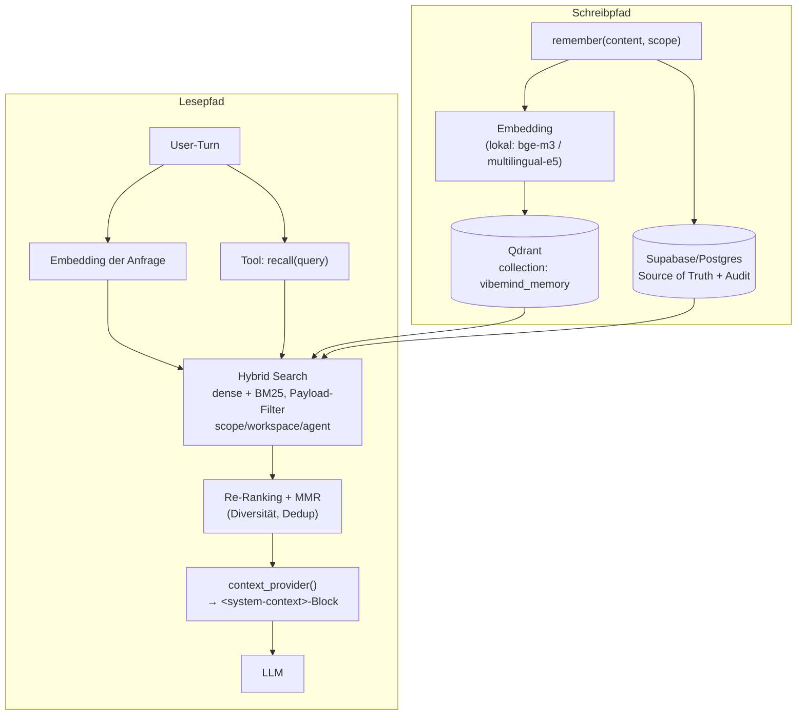

# 06 — Memory

---

## 6.1 Welche Formen existieren

OpenWorker hat **sieben** unterschiedliche Zustandsspeicher, aber nur **einen** davon
nennt es „Memory". Die Trennung ist real, die Abstraktion fehlt.

| Form | Ort | Persistenz | Abruf | Bewertung |
|---|---|---|---|---|
| **Konversation (Kurzzeit)** | `TurnEngine.messages` | `conversations/<id>.jsonl` (append-only) + SQLite-Index | vollständig in den Prompt | **B** — kanonisch, aber unbegrenzt |
| **Langzeit-Memory** | `SQLiteMemoryStore` | `coworker.db`, Tabelle `memories` | **alles** in den Systemprompt | **C-** — siehe unten |
| **Kontext (ephemer)** | `context_provider()` | ❌ nie persistiert | an die letzte User-Message angehängt | **A** — sauberes Muster |
| **Dateien** | Workspace/Roots | Dateisystem | über `read_file`/`grep` | B |
| **Skills** | `SKILL.md`-Ordner | Dateisystem | Progressive Disclosure ✅ | **A** |
| **Embeddings / Vektoren** | — | — | — | **existiert nicht** |
| **Cache** | — | — | — | **existiert nicht** |

---

## 6.2 Der Memory-Store

`coworker/memory/base.py` + `sqlite_store.py`, zusammen 229 Zeilen.

```sql
CREATE TABLE memories (
    id         INTEGER PRIMARY KEY AUTOINCREMENT,
    scope      TEXT NOT NULL,        -- global | workspace | session
    key        TEXT,
    content    TEXT NOT NULL,
    workspace  TEXT,
    session_id TEXT,
    created_at TEXT DEFAULT CURRENT_TIMESTAMP
)
```

Das ist die **vollständige** Definition. Es gibt:
- **keinen Index** (nicht einmal auf `scope` oder `workspace`),
- **keine Volltextsuche** (kein FTS5),
- **keine Embeddings**,
- **kein Verfallsdatum**, kein `updated_at`, kein Zugriffszähler,
- **keine Relationen** — jedes Item ist ein isolierter String,
- **keine Deduplikation** außer der Bitte an das Modell, vorher zu prüfen.

### Der Abruf ist kein Abruf

`agent.py:255-260`:

```python
remembered = memory_store.list(scope=Scope.GLOBAL)
if ws is not None:
    remembered += memory_store.list(scope=Scope.WORKSPACE, workspace=str(ws))
block = format_memories(remembered)          # → "- [#3] …\n- [#7] …"
instructions = f"{instructions}\n\n{block}"
```

**Alle** globalen plus **alle** Workspace-Memories wandern **ungefiltert** in den
Systemprompt. Es gibt keine Relevanzbewertung, kein Top-k, keine Obergrenze.

Skalierungsverhalten:

| Anzahl Memories | Prompt-Overhead (grob, 30 Token/Item) |
|---|---|
| 20 | ~600 Token — unkritisch |
| 100 | ~3.000 Token — spürbar |
| 500 | ~15.000 Token — dominiert den Prompt |
| 2.000 | ~60.000 Token — **System unbenutzbar** |

Das ist kein Memory-System. Es ist eine **globale Notizliste mit Prompt-Injektion**.

### Was daran trotzdem gut ist

**Die Prompt-Governance** (`agent.py:62-73`) ist besser als das Speichersystem:

> „Use `remember` for durable facts: the user's corrections and stated preferences
> (include the why), and project context you couldn't rederive from the code. **Don't
> save what the repo already records** … Use absolute dates, never 'yesterday'. …
> Before saving, check the known-memories list: if an entry already covers it, **revise**
> that entry with `memory_update` instead of adding a near-duplicate … **Memories reflect
> when they were written.** If one names a file, flag, or URL, verify it still exists
> before relying on it."

Das sind fünf echte Erkenntnisse über Agenten-Memory, die die meisten Systeme nicht
haben:
1. Präferenzen **mit Begründung** speichern (macht sie überprüfbar),
2. **nicht** speichern, was ableitbar ist (verhindert Rauschen),
3. absolute Daten (verhindert Zeitbezug-Verfall),
4. **Revidieren statt Duplizieren** (aktive Kuratierung),
5. **Memory ist eine Momentaufnahme, kein Fakt** (verhindert stale-data-Fehler).

**Das ist für VibeMind direkt übernehmbar** — als Governance-Regelwerk über einem
richtigen Speicher ([ADR-0008](adr/ADR-0008-memory-architektur.md)).

Die ID-Anzeige (`format_memories` rendert `- [#7] …`) ist ebenfalls klug: das Modell
kann gezielt `memory_update(7, …)` oder `memory_forget(7)` aufrufen.

---

## 6.3 Der `MemoryStore`-Vertrag

`memory/base.py:33-61` — ein ABC mit `add / get / list / update / delete`.
Der Docstring sagt: „Backends are adapters (`SQLiteMemoryStore` now,
`PostgresMemoryStore` later)."

**Das ist der einzige Angelpunkt für eine Qdrant-Integration** — und er ist zu schmal:

| Was der Vertrag hat | Was Vektorspeicher brauchen |
|---|---|
| `list(scope, workspace, session_id)` | `search(query, top_k, filters)` |
| — | `upsert(id, content, embedding, metadata)` |
| — | Hybrid-Suche (dense + sparse/BM25) |
| — | Payload-Filter |
| — | Batch-Operationen |
| — | Kollektions-/Namespace-Verwaltung |

Man kann Qdrant **nicht** hinter diesem Interface implementieren, ohne es zu erweitern.

---

## 6.4 Wie würde man Qdrant integrieren?

Zwei Wege — der zweite ist der richtige.

### Weg A: Adapter hinter dem bestehenden ABC (schnell, aber falsch)

`QdrantMemoryStore(MemoryStore)` implementiert `add/get/list/update/delete`.
`list()` würde dann *alles* zurückgeben (wie heute), Embeddings blieben ungenutzt.
Man gewinnt nur den Speicherort, nicht die Semantik. **Nicht empfohlen.**

### Weg B: Vertrag erweitern, Abruf umbauen (empfohlen)

```python
class SemanticMemoryStore(MemoryStore):
    def search(self, query: str, *, top_k: int = 8,
               scope: Scope | None = None,
               workspace: str | None = None,
               min_score: float = 0.0) -> list[ScoredMemoryItem]: ...
    def upsert(self, item: MemoryItem, embedding: list[float] | None = None) -> MemoryItem: ...
```

Und dann die **entscheidende** Änderung im Runtime-Pfad:

| Heute | Mit Qdrant |
|---|---|
| Alle Memories → Systemprompt (statisch, beim Build) | **Kein** Memory im Systemprompt |
| — | `recall(query, top_k)` als **Tool** — das Modell ruft ab, wenn es etwas braucht |
| — | **plus** automatischer Pre-Turn-Recall: Top-k zur aktuellen User-Nachricht, injiziert über den existierenden `context_provider()`-Mechanismus (`agent.py:297-307`) |

Der `context_provider`-Hook ist bereits da und tut genau das Richtige: er hängt
ephemeren Kontext an die *letzte User-Message* an und persistiert ihn **nie**
(`engine.py:963-981`). Das ist der ideale Einhängepunkt für RAG-Recall — pro Turn neu,
ohne die Historie zu verschmutzen.

### Skizze für VibeMind



**Payload-Felder, die VibeMind braucht** (aus OpenWorkers Lücken abgeleitet):

| Feld | Warum |
|---|---|
| `scope`, `workspace`, `space`, `agent_id` | Mandantentrennung entlang der VibeMind-Spaces |
| `created_at`, `updated_at`, `last_accessed`, `access_count` | Verfall und Nutzungsgewichtung — fehlt bei OpenWorker komplett |
| `source` (`user_stated` / `agent_inferred` / `tool_derived`) | **Prompt-Injection-Abwehr:** vom Agenten aus Fremdinhalt abgeleitete Memories dürfen niemals dasselbe Vertrauen haben wie explizite User-Aussagen |
| `confidence`, `supersedes` | Revision statt Duplikat, wie in `_MEMORY_GUIDANCE` gefordert — aber maschinell prüfbar |
| `ttl` / `expires_at` | Zeitgebundene Fakten laufen ab, statt zu vergiften |

---

## 6.5 Memory Graph (VibeMind-Zielarchitektur)

Die VibeMind-Zielarchitektur nennt explizit einen **Memory Graph**. OpenWorker liefert
dazu **nichts** — Memories sind isolierte Strings ohne Kanten.

VibeMind hat im eigenen Bestand bereits Graphkomponenten (`STARTUP_PROFILES.md`:
MiroFish „Idea-Scoring-KG, neo4j"; La-Fungus als Search-Layer). Der richtige Schnitt ist
deshalb **nicht**, OpenWorkers Memory zu erweitern, sondern:

| Schicht | Technologie | Inhalt |
|---|---|---|
| **Episodisch** | Postgres/Supabase + JSONL | Was ist passiert — Turns, Tool-Calls, Ergebnisse |
| **Semantisch** | Qdrant | Was bedeutet es — Embeddings über Memories, Dokumente, Code |
| **Relational** | Neo4j (vorhanden) | Wie hängt es zusammen — Entitäten, Projekte, Personen, Artefakte |
| **Prozedural** | Skills/Personas (Dateisystem) | Wie macht man etwas — direkt aus OpenWorker übernehmbar |
| **Arbeitsspeicher** | Redis | Was gerade zählt — Session-State, Worker-Koordination |

OpenWorker deckt davon **eine halbe Schicht** ab (prozedural, plus ein Rudiment von
episodisch). Der Rest ist Neuentwicklung.

---

## 6.6 Cache

Existiert nicht. Kein Prompt-Cache-Management (weder Anthropic-`cache_control` noch
OpenAI-Prefix-Caching wird angesteuert), kein Tool-Result-Cache, kein
Embedding-Cache, kein HTTP-Cache für `web_fetch`.

Für VibeMind mit Redis im Stack ist das eine offene, günstige Verbesserung:
Tool-Results deterministischer Reads (`read_file`, `git_log`, `web_fetch`) sind
cachebar; bei Multi-Agent-Fan-out mit überlappenden Recherchen ist der Gewinn erheblich.

---

## 6.7 Entscheidung

| Komponente | Entscheidung | Begründung |
|---|---|---|
| `SQLiteMemoryStore` | **Nicht übernehmen** | Kein Index, kein Retrieval, kein Verfall. Trivial nachzubauen. |
| `MemoryStore`-ABC | **Übernehmen und erweitern** | Richtiger Ansatz, zu schmal. `search()`/`upsert()` ergänzen. |
| `_MEMORY_GUIDANCE`-Regelwerk | **Direkt übernehmen** | Fünf echte Erkenntnisse, sofort wirksam. |
| ID-sichtbare Memory-Liste (`[#7]`) | **Übernehmen** | Ermöglicht gezielte Revision durch das Modell. |
| Statische Prompt-Injektion aller Memories | **Verwerfen** | Skaliert nicht über ~100 Items. |
| `context_provider()`-Hook | **Übernehmen** | Idealer Einhängepunkt für RAG-Recall. |
| Skills-Progressive-Disclosure | **Übernehmen** | Bereits das richtige Muster — auf Memory *und* Tools ausdehnen. |
| Memory Graph | **Neu entwickeln** | 5-Schichten-Modell, siehe [ADR-0008](adr/ADR-0008-memory-architektur.md). |

---

**Weiter:** [07 — Desktop Automation](07-desktop-automation.md)
