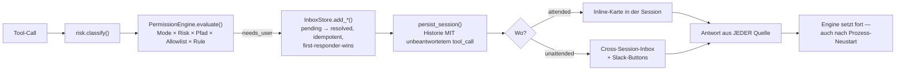

# 13 — Vergleich mit der VibeMind-Zielarchitektur

> **Quellenlage:** Die VibeMind-Seite stützt sich auf `vibemind.config.json`,
> `infra/swarm/STARTUP_PROFILES.md`, `intent_validation/00_MASTER.md`,
> `mcp/docker/approval.py` und die vom Auftraggeber genannte Zielarchitektur.
> Das Submodul `vibemind-os/` ist in diesem Checkout **nicht ausgecheckt** —
> Modul-Internas sind daher **nicht verifiziert** und entsprechend markiert.

---

## 13.1 Die beiden Systeme nebeneinander

| | **OpenWorker** | **VibeMind (Ziel)** |
|---|---|---|
| Zweck | Persönlicher AI-Coworker am Desktop | Voice-first Agentic OS, orchestriert eine digitale Entwicklungsabteilung |
| Topologie | **1 Prozess**, lokal, `127.0.0.1` | **~36 Services**, Docker Swarm, verteilte Module |
| Eingabe | Text (Tastatur), Diktat als Zusatz | **Sprache primär** |
| Ausgabe | Text + Dateien | Sprache + Text + Artefakte |
| Agenten | 1 pro Session (+ read-only `explore`) | Multi-Agent (AutoGen), Worker Pool |
| Planung | Prompt + Permission-Mode | Expliziter Planner + Workflow-Auswahl |
| Integration | 33 eingebaute Connectoren, geschlossen | n8n als Integrations-Engine, offen |
| Desktop | Browser (Playwright) | OpenClaw + Automation_ui (19 Perception-Tools) |
| Memory | SQLite-Liste im Prompt | Memory Graph (Qdrant + Supabase + Neo4j) |
| Persistenz | SQLite + JSONL, lokal | Supabase/Postgres + Redis + Qdrant |
| Skalierung | ein Rechner | Swarm/Proxmox |
| Routing | keines (Modell wählt aus flacher Liste) | Brain Cap-Router, `execution_target`, 446 Intents |

**Fundamentale Beobachtung:** Diese Systeme lösen unterschiedliche Probleme.
OpenWorker optimiert für **Einfachheit und Datenhoheit auf einem Rechner**.
VibeMind optimiert für **Orchestrierung vieler spezialisierter Dienste**.

Eine architektonische Übernahme im Ganzen ist deshalb ausgeschlossen. Die richtige
Frage ist nicht „übernehmen wir OpenWorker", sondern **„welche seiner gelösten Probleme
hat VibeMind noch nicht gelöst".**

---

## 13.2 Schicht-für-Schicht gegen die Zielarchitektur

```
Voice → Planner → Workflow Selection → AutoGen → Worker Pool → n8n
      → Desktop Automation → Memory Graph → Response
```

### Voice

| | |
|---|---|
| **OpenWorker** | Push-to-Talk-Diktat, Whisper `base.en` (Englisch), Batch, kein TTS, kein Wake-Word, nur Tauri |
| **VibeMind Ziel** | Wake-Word → Streaming-STT → Intent → … → Streaming-TTS mit Barge-in |
| **VibeMind Ist** | „native STT/TTS **unvollständig**" (`STARTUP_PROFILES.md`) |
| **Passung** | ❌ **Keine.** OpenWorker schließt die Lücke nicht einmal teilweise |
| **Was übernehmbar ist** | Modell-Provisioning-Muster (Download+SHA+Marker), Cancellation als Barge-in-Fundament, Stream-Gate als TTS-Commit-Vorbild |

→ [ADR-0010](adr/ADR-0010-voice-pipeline-neuentwicklung.md)

### Intent

| | |
|---|---|
| **OpenWorker** | Existiert nicht. Text geht unverändert ans LLM, das aus 230 Tools wählt |
| **VibeMind Ist** | Brain Cap-Router mit `capabilities.yaml`, `execution_target`, hot-reloadbar; 446 Intents über 19 Kategorien; validierte Routing-Genauigkeit (Kat 0: 7/7, Kat 2: 15/15, Kat 3: 5/5) |
| **Passung** | ❌ VibeMind ist hier **deutlich weiter** |
| **Lehre aus OpenWorker** | Negativ-Lehre: Die Fehlwahl-Analyse in `00_MASTER.md` (#7 `bubble_evaluate` statt `idea_find`) zeigt das Problem bereits bei kleiner Toolmenge — bei 230 flachen Tools wäre es unbeherrschbar. **Bestätigt die Cap-Router-Entscheidung.** |

### Planner

| | |
|---|---|
| **OpenWorker** | ❌ Existiert nicht. `propose_plan` ist ein Genehmigungs-Tool, kein Planer |
| **VibeMind Ist** | `som-planner` (async, „hard"-Pfad) laut `00_MASTER.md`; Reifegrad nicht verifizierbar |
| **Passung** | ❌ Nichts übernehmbar |
| **Was übernehmbar ist** | **Ein Muster:** Plan-Genehmigung schaltet den Permission-Mode der *laufenden* Session um (`engine.py:740-751`) — Kontext bleibt, kein Neustart. Das ist die richtige Kopplung von Plan und Autonomie. |

→ [ADR-0011](adr/ADR-0011-planner-neuentwicklung.md)

### Workflow Selection / n8n

| | |
|---|---|
| **OpenWorker** | ❌ Keine Workflow-Engine. Nur Cron (`automation/scheduler.py`) |
| **VibeMind Ist** | n8n (`:15678`) als Integrations-Engine, im Stack |
| **Passung** | ❌ |
| **Was übernehmbar ist** | Das **Automation-Datenmodell**: `ScheduledTask` mit eigenem Thread, eigenem Arbeitsordner, eigenen Standing Rules, Run-Historie, „run-once-catch-up" + „skip-on-overlap" (`scheduler.py:3-6`). Das ist eine saubere Semantik für wiederkehrende Agenten-Arbeit, die n8n so nicht liefert. |

### AutoGen / Multi-Agent

| | |
|---|---|
| **OpenWorker** | ❌ Kein Multi-Agent. Ein `explore`-Subagent, read-only, keine Rekursion, nur für Code-Personas |
| **VibeMind Ist** | AutoGen vorgesehen; `agentfarm`-Modul in `vibemind.config.json` **deaktiviert** („Docker build references … which doesn't exist; needs source restore") |
| **Passung** | ❌ |
| **Was übernehmbar ist** | Der **Isolationsmechanismus** des Subagenten: Kind-Engine mit hart erzwungenem `Mode.PLAN`, ohne Approver, ohne Rekursionsmöglichkeit, eigenes Kontextfenster, nur der Report kehrt zurück (`tools/subagent.py:1-11`). **Das ist genau das Sicherheitsmodell, das ein Worker im Pool braucht** — die Rechte des Kindes sind strukturell, nicht per Prompt begrenzt. |

→ [ADR-0012](adr/ADR-0012-multi-agent-runtime.md)

### Worker Pool

| | |
|---|---|
| **OpenWorker** | ❌ Kein Pool. `asyncio.to_thread` auf dem Default-Executor, ungebunden ([11 B-03](11-performance.md#b-03)) |
| **VibeMind Ist** | Redis im Stack (`redis_voice:6379`, `coding_redis:6382`) — Infrastruktur vorhanden |
| **Passung** | ❌ |
| **Lehre** | Negativ: Der Scheduler-Kommentar „spawn, don't await" (`scheduler.py:76-79`) ist richtig erkannt, aber ohne Obergrenze umgesetzt. VibeMind braucht **von Anfang an** Queue + Priorität + Semaphore. |

### Desktop Automation

| | |
|---|---|
| **OpenWorker** | 11 Playwright-Tools, Modul-Singleton, `headless=False` fest, keine Session-Isolation |
| **VibeMind Ist** | OpenClaw dual (Docker `:18789` headless / Native `:18793` visible) ✅ live; Automation_ui `:8007` mit 19 Perception-Tools ✅; „eyeTerm gaze/dwell **nicht** implementiert" |
| **Passung** | ❌ VibeMind ist **weiter** |
| **Was übernehmbar ist** | `_SNAPSHOT_JS` — die kompakte Seitenrepräsentation (Text + sichtbare Controls + `selectorHint`) in unter 40 Zeilen JS. Direkt nach OpenClaw portierbar. Plus: Approval **pro Aktion**. |

### Memory Graph

| | |
|---|---|
| **OpenWorker** | SQLite-Tabelle ohne Index, **alle** Einträge in den Systemprompt, keine Embeddings, kein Verfall, keine Relationen |
| **VibeMind Ist** | Qdrant + Supabase geplant; MiroFish mit Neo4j-KG ✅ live; La-Fungus als Such-Layer ✅; Supermemory-Key konfiguriert |
| **Passung** | ❌ VibeMind ist **weiter** |
| **Was übernehmbar ist** | Das **`_MEMORY_GUIDANCE`-Regelwerk** (`agent.py:62-73`) — fünf echte Erkenntnisse über Agenten-Memory, sofort wirksam. Plus das ID-sichtbare Format `[#7]`, das gezielte Revision ermöglicht. |

→ [ADR-0008](adr/ADR-0008-memory-architektur.md)

### Response

| | |
|---|---|
| **OpenWorker** | Text-Stream + Artefakt-Links (`artifact:pfad`), Stream-Gating |
| **VibeMind Ziel** | Sprachantwort + Artefakte |
| **Passung** | ⚠️ Teilweise |
| **Was übernehmbar ist** | **Artefakt-Links im Antworttext** (Format `[Titel](artifact:<relativer-pfad>)` als Literal, plus Ein-Klick-Öffner) — löst „Deliverable statt Chat" elegant. Und das **Stream-Gate** als Vorbild für TTS-Commit-Punkte. |

---

## 13.3 Was OpenWorker hat, das VibeMind fehlt

Das ist die eigentlich interessante Richtung. Fünf Dinge:

### (1) Die Human-in-the-Loop-Governance-Schicht — **das Kernstück**



**Warum VibeMind das braucht:** VibeMind hat `mcp/docker/approval.py` — eine
env-gesteuerte Default-Deny-Allowlist für Docker-Verben. Handwerklich gut
(`container:rm` ≠ `stack:rm`, Flag-Werte werden korrekt übersprungen), aber es ist
**statisch**: keine Laufzeit-Nachfrage, kein Prompt-Kanal
(„stdio MCP has no interactive prompt channel"), keine Persistenz, keine Wiederaufnahme.

Für eine „digitale Entwicklungsabteilung" mit 446 Intents, davon sensible Kategorien
(HR mit 12 Skills, Bürgergeld mit 7, Security/Ops, Marketing-Send), ist eine
**einheitliche, persistente, kanalübergreifende Genehmigungsschicht** unverzichtbar —
und sie ist genau das, was OpenWorker am besten gebaut hat.

→ [ADR-0001](adr/ADR-0001-inbox-governance.md)

### (2) Cancellation-Invarianten

Abbruch aus jedem Zustand, mit der Garantie, dass jeder ausstehende `tool_call` eine
Antwort in der Historie bekommt. **Das ist die Voraussetzung für Barge-in.**
VibeMind hat das (nach verfügbarer Doku) nicht.

→ [ADR-0003](adr/ADR-0003-cancellation-invarianten.md)

### (3) Durable Resume ohne Workflow-Engine

Ein Turn, der auf eine Genehmigung wartet, überlebt den Prozess-Neustart — allein
dadurch, dass die Nachrichtenliste vollständig genug ist, um den Zustand zu
rekonstruieren. Kein Temporal, kein Event-Store, ~40 Zeilen Code.

### (4) Risikoklassifikation als deklarative Tool-Eigenschaft

Vier Klassen, ein `classify()`, User-Overrides. Löst das Problem
„welches Tool braucht welche Aufsicht" ohne if-Kaskaden.

→ [ADR-0002](adr/ADR-0002-risk-klassifikation.md)

### (5) Testkultur für Agentenverhalten

881 Tests, davon viele für genau die Verhaltensweisen, die schwer zu testen sind:
Stop mitten im Turn, Resume nach Neustart, Standing Rules, Approval-Ownership über
Slack. Plus ein In-Process-FakeSlack, der den echten Handler treibt.

VibeMind hat mit `intent_validation/` bereits eine gute Routing-Test-Harness
(4 Assertions pro Intent: LEVEL, TARGET, AGENT, E2E) — aber die *Verhaltens*-Ebene
(Abbruch, Wiederaufnahme, Genehmigung) fehlt dort.

---

## 13.4 Was VibeMind hat, das OpenWorker fehlt

Zur Fairness und zur Vermeidung falscher Übernahmen:

| VibeMind | OpenWorker |
|---|---|
| Intent-Routing über Capability-Router mit 446 kartierten Intents | ❌ Modell wählt aus flacher Liste |
| Verteilte Service-Architektur (Swarm, ~36 Services, Startup-Profile) | ❌ ein Prozess |
| Neo4j-Wissensgraph (MiroFish) | ❌ |
| n8n als Integrations-Engine | ❌ nur Cron |
| Docker-basierte Isolation (OpenClaw headless) | ❌ kein Sandboxing |
| Desktop-Perception (19 Tools) | ❌ nur Browser-DOM |
| Systematische Intent-Validierung mit Regressionstracking | ⚠️ Unit/E2E, aber keine Intent-Ebene |
| Mehrsprachigkeit (deutschsprachiger Betrieb) | ❌ STT nur Englisch |
| Redis, Supabase, Qdrant im Stack | ❌ SQLite + JSON |

---

## 13.5 Passungsmatrix

| Zielarchitektur-Schicht | Passt direkt | Muss ersetzt werden | Fehlt komplett |
|---|---|---|---|
| **Voice** | — | ocw-stt (Batch/EN) | Wake, VAD, Streaming-STT, TTS, Barge-in |
| **Intent** | — | — | vollständig (VibeMind hat es bereits) |
| **Planner** | Mode-Umschaltung bei Plan-Approval | `propose_plan` als Planersatz | Zerlegung, DAG, Replanning, HTN |
| **Workflow** | Automation-Datenmodell (Task/Run/Rules) | Cron-only-Scheduler | Event-Trigger, Workflow-Engine |
| **AutoGen** | Subagent-Isolationsmodell | `explore` (read-only) | A2A, Rollen, Gruppenkoordination |
| **Worker Pool** | — | `to_thread` ungebunden | Queue, Priorität, Backpressure |
| **n8n** | — | — | vollständig |
| **Desktop** | `_SNAPSHOT_JS`, Approval-pro-Aktion | Browser-Singleton | Accessibility-Baum, Record/Replay |
| **Memory Graph** | `_MEMORY_GUIDANCE`, `context_provider`-Hook | SQLite-Store | Embeddings, Graph, Verfall, Provenienz |
| **Response** | Artefakt-Links, Stream-Gate | — | TTS-Commit-Gate |
| **Governance (quer)** | **Inbox, Risk, Permission, Durable Resume, Audit, Standing Rules** | Secret-Store | Sandbox, Taint-Tracking |

**Die Diagonale ist eindeutig:** OpenWorker liefert VibeMind **eine** Schicht —
die querschnittliche Governance-Schicht — und in den anderen Schichten nur einzelne
Muster. Genau so sollte die Übernahme geschnitten werden.

---

**Weiter:** [14 — Integrationsempfehlungen](14-integrationsempfehlungen.md)
