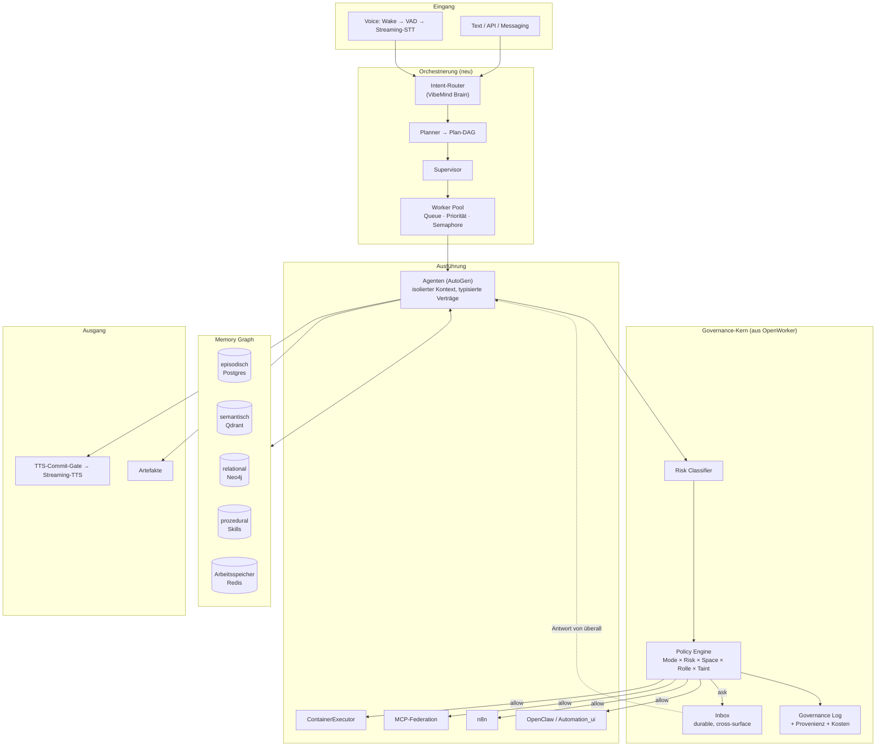

# 16 — Hypothetisches „OpenWorker V2"

> Übung mit Zweck: Die Änderungen, die OpenWorker V2 bräuchte, sind exakt die
> Entscheidungen, die VibeMind **von Anfang an** richtig treffen kann. Jede Änderung
> ist deshalb mit ihrer VibeMind-Konsequenz versehen.

---

## 16.1 Die zehn Architekturentscheidungen, die ich ändern würde

### V2-1 · Executor-Isolation als Default, nicht als Hedge

**Heute:** `Executor`-ABC existiert, nur `LocalExecutor` ist implementiert
(`tools/shell.py:55`).

**V2:** Drei Implementierungen, `ContainerExecutor` als Default.

```python
class ExecutionPolicy:
    backend: Literal["local", "container", "vm"] = "container"
    network: Literal["none", "allowlist", "full"] = "allowlist"
    mounts: list[Mount]                     # nur Roots, explizit
    limits: ResourceLimits                  # CPU, RAM, PIDs, Wall-Clock
    egress_allowlist: list[str]
```

`LocalExecutor` bleibt — hinter einer bewussten „Ich verstehe das Risiko"-Einstellung.

**VibeMind:** Docker ist bereits die Betriebsform. `ContainerExecutor` ist hier kein
Zusatz, sondern der natürliche Weg. → [ADR-0006](adr/ADR-0006-shell-executor.md)

### V2-2 · Kontext als verwaltete Ressource

**Heute:** `messages` wächst unbegrenzt; Tool-Results bis 20 k Zeichen inline.

**V2:** Ein `ContextManager` zwischen Engine und Provider mit vier Mechanismen:

| Mechanismus | Wirkung |
|---|---|
| **Token-Budget pro Turn** | Harte Obergrenze, bevor der Provider sie durchsetzt |
| **Sliding Window + hierarchische Summaries** | Ältere Turns werden zu Zusammenfassungen verdichtet, Zusammenfassungen wiederum zu Meta-Zusammenfassungen |
| **Artefakt-Handles** | Tool-Result > n KB → Datei/Objektspeicher, Modell erhält `{handle, summary, schema}` und kann per `read_artifact(handle, range)` nachladen |
| **Stabiler Cache-Prefix** | Systemprompt ohne dynamische Anteile; Memories/Roots nur im ephemeren `<system-context>` |

**Der letzte Punkt ist die billigste Verbesserung überhaupt:** OpenWorker packt
Memories in den Systemprompt (`agent.py:255-260`) und zerstört damit den cachebaren
Prefix. Der ephemere Kontextblock existiert bereits — die Memories gehören dorthin.

**VibeMind:** → [ADR-0017](adr/ADR-0017-kontext-management.md)

### V2-3 · Tool-Registry mit Namespaces und Retrieval

**Heute:** flache `dict[str, ToolSpec]`, stilles Überschreiben, alle Schemas immer.

**V2:**
- Namespaces: `local:read_file`, `mcp:github/create_issue`, `connector:slack/send`.
- **Kollision = Fehler**, nicht Überschreiben.
- Dreistufige Sichtbarkeit pro Turn:
  1. **immer sichtbar**: Kern-Tools (~10),
  2. **kategorisiert sichtbar**: ein Katalogeintrag pro Namespace mit
     `load_toolset(namespace)` (Progressive Disclosure — dasselbe Muster, das für
     Skills bereits existiert),
  3. **retrieval-basiert**: Top-k Tools per Embedding-Ähnlichkeit zur aktuellen Aufgabe.
- **Rollen-Scoping**: Der Planner sieht Planungs-Tools, der Worker Ausführungs-Tools.

**VibeMind:** → [ADR-0007](adr/ADR-0007-tool-registry-namespaces.md)

### V2-4 · Event Sourcing für den Session-Zustand

**Heute:** Die Nachrichtenliste ist der Zustand; Events sind reine UI-Benachrichtigungen.
Durable Resume funktioniert nur an Prompt-Punkten.

**V2:** Das Event-Log **ist** die Wahrheit; die Nachrichtenliste ist eine Projektion.

```
Events:  TurnStarted · MessageAppended · ToolProposed · PermissionDecided
         ToolStarted · ToolOutputChunk · ToolFinished · TurnEnded · Interrupted
Projektionen:  conversation_view · audit_view · cost_view · timeline_view
```

**Gewinn:** Wiederaufnahme an *jeder* Stelle (nicht nur an Prompts), Zeitreise-Debugging,
Kostenrechnung ohne Zusatzcode, Audit als Projektion statt als Parallelsystem.

**Trade-off:** Deutlich mehr Komplexität. **Für OpenWorker (ein lokaler Prozess) wäre
das überzogen** — für VibeMind (verteilt, Multi-Agent, Compliance-relevante Kategorien
wie HR/Bürgergeld) ist es angemessen.

**Ehrliche Einschätzung:** Volles Event Sourcing mit CQRS ist der Punkt, an dem viele
Projekte sich verheben. Empfehlung für VibeMind: **Event-Log als Append-Only-Journal
mit Projektionen, aber ohne strikte CQRS-Trennung** — 80 % des Nutzens, 30 % der Kosten.

### V2-5 · Multi-Agent als erstklassiges Konzept

**Heute:** ein `explore`-Subagent, read-only, keine Rekursion.

**V2:** Ein `AgentGraph` mit typisierten Kanten:

```
Supervisor ──delegate──▶ Worker(role=implementer, scope=…, budget=…)
           ──delegate──▶ Worker(role=reviewer,    scope=read-only)
           ◀──report─── beide
Worker     ──escalate─▶ Supervisor        (bei Blockade / Budgetende)
Worker     ──handoff──▶ Worker            (Übergabe mit Kontextpaket)
```

Mit vier Eigenschaften, die OpenWorkers `explore` bereits richtig vorwegnimmt:
1. **Rechte strukturell begrenzt**, nicht per Prompt (Kind-PermissionEngine),
2. **eigener Kontext**, nur das Ergebnis kehrt zurück,
3. **keine unkontrollierte Rekursion** (Tiefenlimit + Budget),
4. **Ergebnis ist ein Vertrag** (typisiertes Schema statt Freitext).

Punkt 4 ist die wichtigste Ergänzung: `explore` gibt einen Markdown-Report zurück;
ein Worker im Pool muss ein **validiertes Schema** zurückgeben, sonst ist die
Komposition nicht automatisierbar.

**VibeMind:** → [ADR-0012](adr/ADR-0012-multi-agent-runtime.md)

### V2-6 · Planner als Komponente

**Heute:** `propose_plan` ist ein Genehmigungs-Tool.

**V2:** Ein Planner, der ein **prüfbares Artefakt** erzeugt:

```yaml
plan:
  goal: "…"
  steps:
    - id: s1
      intent: analyze_repository
      agent: explorer
      inputs: {…}
      expected_output_schema: {…}
      depends_on: []
      budget: {tokens: 50000, wall_clock_s: 300}
      risk: read
    - id: s2
      depends_on: [s1]
      ...
  verification:
    - "Tests grün"
    - "Keine neuen Lint-Fehler"
```

Damit wird der Plan: genehmigbar (wie heute), **ausführbar** (DAG), **prüfbar**
(Verifikationskriterien), **replanbar** (bei Fehlschlag eines Schritts wird nur der
Teilbaum neu geplant) und **budgetierbar**.

Die richtige Eigenschaft aus V1 bleibt: **Plan-Genehmigung schaltet den Permission-Mode
der laufenden Session um** — Kontext bleibt erhalten.

**VibeMind:** → [ADR-0011](adr/ADR-0011-planner-neuentwicklung.md)

### V2-7 · Taint-Tracking gegen Prompt Injection

**Heute:** ein Satz im Systemprompt.

**V2:** Jede Nachricht trägt eine Herkunft; die effektive Autonomie hängt davon ab:

```python
class Provenance(str, Enum):
    USER = "user"                    # direkt vom Menschen
    TOOL_LOCAL = "tool_local"        # eigene Dateien, eigene Shell
    TOOL_EXTERNAL = "tool_external"  # Connector-Daten (Tickets, Mails, Chats)
    WEB = "web"                      # abgerufene Seiten
    AGENT = "agent"                  # von einem anderen Agenten

TAINT_ORDER = [USER, TOOL_LOCAL, AGENT, TOOL_EXTERNAL, WEB]
```

Regeln:
1. Nach Konsum von `TOOL_EXTERNAL`/`WEB` sinkt der effektive Mode — kein `auto`,
   **keine** Standing Rules, bis zur nächsten `USER`-Nachricht.
2. Der Approval-Prompt **zeigt die Herkunft**: „ausgelöst nach dem Lesen von
   Jira-Ticket #421 (externe Quelle)".
3. Fremdinhalt wird strukturell umschlossen (`<untrusted origin="jira:…">`), nicht frei
   in die Historie gemischt.
4. Egress-Tools (`web_fetch`, `send_message`) prüfen gegen eine Allowlist, sobald
   Taint erhöht ist.

Kostet wenig, verändert die Sicherheitslage grundlegend.
**Kein System im Vergleich ([15](15-architekturvergleich.md#154-sicherheit)) hat das.**

**VibeMind:** → [ADR-0015](adr/ADR-0015-taint-tracking.md)

### V2-8 · Semantic Memory statt Notizliste

Siehe [06](06-memory.md) und [ADR-0008](adr/ADR-0008-memory-architektur.md).
Kern: Recall statt Injektion, Embeddings, Provenienz, Verfall, Zugriffsgewichtung.

### V2-9 · Worker Pool mit Backpressure

**Heute:** `to_thread` auf dem Default-Executor, unbegrenzt.

**V2:**

```python
class WorkPool:
    queues: {interactive: high, automation: normal, background: low}
    semaphores: {llm: n, shell: m, browser: k, mcp_per_server: 1}
    def submit(task, *, priority, budget) -> Handle
    def backpressure() -> PoolState     # ans UI: "3 Aufgaben in Warteschlange"
```

Mit: Priorisierung (interaktive Session vor Automation), Ressourcen-Semaphoren,
sichtbarem Rückstau, Deadline-Propagierung, und einem **Kill-Switch pro Space**.

**VibeMind:** → [ADR-0014](adr/ADR-0014-worker-pool.md)

### V2-10 · Observability

**Heute:** `audit.py` (Tool-Entscheidungen), sonst nichts.

**V2:** OpenTelemetry durchgängig:
- **Traces**: Turn → Iteration → Tool-Call → Provider-Call → Subagent (verschachtelt).
- **Metriken**: Token/Kosten pro Session/Agent/Tool, Tool-Fehlerrate,
  Approval-Latenz, Cache-Trefferquote, Warteschlangentiefe.
- **Logs**: strukturiert, mit `trace_id`.
- **Evals**: eine Testharness, die Agentenverhalten gegen Referenzaufgaben misst —
  VibeMind hat mit `intent_validation/` bereits die halbe Antwort.

**Ohne Tracing ist ein 12-Agenten-Lauf nicht diagnostizierbar.**

---

## 16.2 Bewertung der genannten Konzepte

Der Auftrag nennt eine Liste moderner Konzepte. Hier die ehrliche Einschätzung, welche
davon VibeMind wirklich braucht — nicht alle sind es.

| Konzept | Für VibeMind | Begründung |
|---|---|---|
| **Event Sourcing** | ⚠️ **teilweise** | Append-Only-Journal + Projektionen: ja. Vollständiges ES mit Replay-only-Zustand: überzogen, hohe Komplexitätskosten. |
| **CQRS** | ❌ **nein** | Löst ein Problem (getrennte Lese-/Schreibskalierung), das VibeMind nicht hat. Trennt Komplexität, ohne Nutzen zu liefern. |
| **Actor Model** | ✅ **ja** | Passt exakt auf „Agent = Aktor mit Postfach und Zustand". Redis + asyncio reichen; Erlang/Akka ist nicht nötig. |
| **Workflow Engine** | ✅ **ja, vorhanden** | n8n ist im Stack. Wichtig: klare Grenze — n8n für *deterministische* Integrationen, Planner für *adaptive* Abläufe. Nicht vermischen. |
| **Durable Execution** | ✅ **ja** | Checkpoints an jeder Stelle (LangGraph-Muster), nicht nur an Prompts. Kritisch für stundenlange Läufe. |
| **Dynamic Agent Graphs** | ⚠️ **später** | Erst statische Rollen beherrschen, dann dynamische Topologie. Sonst ist nichts mehr debugbar. |
| **CRDTs** | ❌ **nein** | Nur nötig bei echter Offline-Kollaboration mehrerer Nutzer am selben Dokument. Nicht VibeMinds Problem. |
| **MCP Federation** | ✅ **ja** | VibeMind hat mehrere MCP-Server; ein Federations-Layer mit Namespaces und Health-Checks ist die natürliche Konsequenz. |
| **Skill Registry** | ✅ **ja** | OpenWorkers Format übernehmen, mit Durchsetzung von `allowed_tools`, Versionierung und Signatur. |
| **Plugin Marketplace** | ⚠️ **später** | Erst intern stabil, dann öffnen. Ein Marktplatz ohne Sandbox ist eine Malware-Verteilstelle. |
| **Semantic Memory** | ✅ **ja, dringend** | Größte funktionale Lücke gegenüber der Zielarchitektur. |
| **Hierarchical Planning** | ✅ **ja** | „Digitale Entwicklungsabteilung" ist per Definition hierarchisch: Ziel → Epics → Tasks → Schritte. |
| **Multi-Agent Coordination** | ✅ **ja** | Kernanforderung; AutoGen ist die richtige Basis, braucht aber die Governance-Schicht darunter. |

**Ergänzungen, die in der Liste fehlen, aber wichtiger sind als einige darin:**

| Konzept | Warum |
|---|---|
| **Taint-Tracking / Informationsfluss-Kontrolle** | Die einzige echte Antwort auf Prompt Injection. Kein Konkurrent hat es. |
| **Budget- und Kostensteuerung pro Aufgabe** | Ohne Budget ist ein Multi-Agent-Lauf finanziell unbegrenzt. |
| **Ergebnis-Verträge (typisierte Agent-Outputs)** | Voraussetzung für automatische Komposition. Freitext-Reports komponieren nicht. |
| **Idempotenzschlüssel für externe Writes** | Voraussetzung für sichere Wiederholung/Wiederaufnahme. |
| **Verteiltes Tracing** | Ohne es ist Multi-Agent nicht betreibbar. |

---

## 16.3 V2-Architekturskizze



**Die Kernaussage der Skizze:** Der Governance-Kern liegt **quer** unter allem —
jeder Agent, jedes Tool, jeder Space geht durch dieselbe Policy-Engine und dieselbe
Inbox. Das ist die Struktur, die OpenWorker für *eine* Session richtig gebaut hat und
die VibeMind für *n* Agenten braucht.

---

**Weiter:** [17 — Migrationsplan](17-migrationsplan-vibemind.md)
