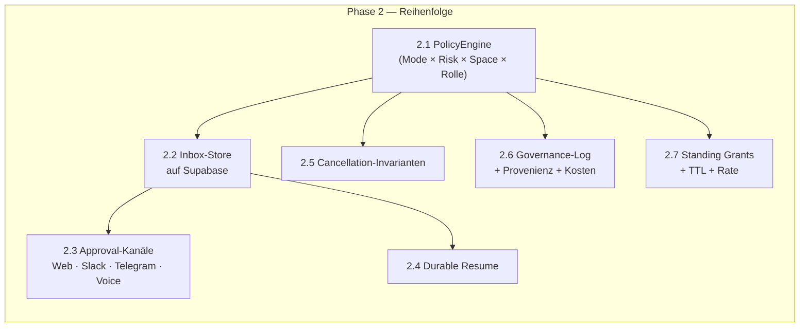
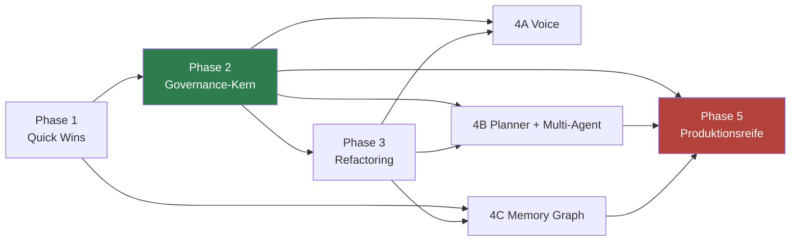

# 17 — Migrationsplan für VibeMind

**Goal:** VibeMind erhält eine einheitliche, durable, kanalübergreifende
Governance-Schicht aus OpenWorker und baut die fehlenden Kernkomponenten
(Voice, Planner, Multi-Agent, Memory, Worker Pool, Sandbox) selbst — in dieser
Reihenfolge, weil jede Phase die nächste absichert.

**Aufwandseinheit:** 1 PW = eine Personenwoche.
**Risiko:** Niedrig / Mittel / Hoch — bezogen auf *Umsetzungsrisiko*, nicht auf Nutzen.

---

## Phasenübersicht

| Phase | Thema | Dauer | Aufwand | Risiko | Nutzen |
|---|---|---|---|---|---|
| **1** | Quick Wins — sofort wirksame Übernahmen | 3 Wochen | 6 PW | **Niedrig** | Hoch |
| **2** | Architekturübernahme — Governance-Kern | 6 Wochen | 14 PW | **Mittel** | **Sehr hoch** |
| **3** | Refactoring — Tools, Kontext, Isolation | 8 Wochen | 20 PW | **Mittel-Hoch** | Hoch |
| **4** | Eigenentwicklung — Voice, Planner, Multi-Agent, Memory | 16 Wochen | 48 PW | **Hoch** | **Sehr hoch** |
| **5** | Produktionsreife — Security, Observability, Betrieb | 8 Wochen | 20 PW | Mittel | Hoch |
| | **Summe** | **~10 Monate** | **~108 PW** | | |

Phasen 3 und 4 können nach Woche 12 teilweise parallel laufen (siehe Abhängigkeitsgraph).

---

## Phase 1 — Quick Wins

> **Ziel:** Messbarer Sicherheits- und Kostengewinn ohne Architekturänderung.
> Jede Maßnahme ist einzeln nutzbar und einzeln zurücknehmbar.

| # | Maßnahme | Quelle | Aufwand | Risiko | Nutzen |
|---|---|---|---|---|---|
| 1.1 | **Risikoklassifikation einführen** (`risk.py` portieren), Default **fail-closed** (`UNKNOWN → EXTERNAL`) | A-2 | 0,5 PW | Niedrig | Basis für alles Weitere |
| 1.2 | **Shell-Allowlist-Härtung** — Metazeichen-Ausschluss + `shlex`-Token-Präfix in alle Stellen, die Kommandos freigeben (inkl. `mcp/docker/approval.py`) | A-4 | 0,5 PW | Niedrig | Schließt eine reale Lücke |
| 1.3 | **Memories aus dem Systemprompt in den ephemeren Kontextblock** verschieben | [11.4](11-performance.md#114-was-vibemind-daraus-baut) | 0,5 PW | Niedrig | **Prompt-Cache wird nutzbar: 50–90 % Ersparnis auf den statischen Anteil** |
| 1.4 | **`_MEMORY_GUIDANCE`-Regelwerk** in alle Agenten-Prompts übernehmen | B-4 | 0,3 PW | Niedrig | Weniger Memory-Rauschen, sofort |
| 1.5 | **Artefakt-Links** (Literal `[Titel](artifact:<pfad>)` + Öffner) in Antworten | A-10 | 1 PW | Niedrig | „Deliverable statt Chat" |
| 1.6 | **Stream-Gating** im Voice-/Chat-Frontend | [09](09-frontend.md) | 1 PW | Niedrig | Keine flackernden Halb-Antworten |
| 1.7 | **`VIBEMIND_STATE_DIR`-Muster** — ein Env-Override isoliert den Zustandsbaum | A-9 | 0,5 PW | Niedrig | Integrationstests werden trivial |
| 1.8 | **CI-Gates**: ruff, mypy (schrittweise), tsc, pip-audit, npm audit, gitleaks | [08 R-11](08-security-risikoanalyse.md#r-11) | 1 PW | Niedrig | Regressionsschutz |
| 1.9 | **Kommentarstandard** (Warum + Incident-Datum) in `AGENTS.md`/`CLAUDE.md` verankern | A-11 | 0,2 PW | Niedrig | Wartbarkeit |

**Abhängigkeiten:** keine. **Ergebnis:** 1.1 ist die Voraussetzung für Phase 2.

**Empfehlung zur Reihenfolge:** 1.3 zuerst — es ist die günstigste Maßnahme mit dem
höchsten unmittelbaren Effekt (Token-Kosten).

---

## Phase 2 — Architekturübernahme: der Governance-Kern

> **Ziel:** Eine Genehmigungsschicht, durch die **jede** konsequenzielle Aktion **jedes**
> Agenten geht — persistent, kanalübergreifend, neustartfest.
> Das ist die wertvollste Übernahme aus OpenWorker.

| # | Maßnahme | Aufwand | Risiko | Nutzen | Abhängig von |
|---|---|---|---|---|---|
| 2.1 | **PolicyEngine** — OpenWorkers `PermissionEngine` portieren, um `space`, `role`, `taint_level` erweitern | 3 PW | Mittel | Sehr hoch | 1.1 |
| 2.2 | **Inbox-Store auf Supabase** — Zustandsautomat `pending → resolved`, idempotent, first-responder-wins | 2 PW | Niedrig | Sehr hoch | — |
| 2.3 | **Approval-Kanäle** — Web-UI-Karten, Slack-Buttons, Telegram, **Voice-Bestätigung** | 3 PW | Mittel | Hoch | 2.2 |
| 2.4 | **Durable Resume** — Turn-Zustand vor jedem Prompt persistieren, unbeantwortete Tool-Calls rekonstruieren | 2 PW | **Mittel-Hoch** | Sehr hoch | 2.2 |
| 2.5 | **Cancellation-Invarianten** — Abbruch aus jedem Zustand, jeder ausstehende Call bekommt eine Antwort | 2 PW | Mittel | Hoch (**Barge-in-Voraussetzung**) | — |
| 2.6 | **Governance-Log** — Stage-Schema + Provenienz + Kosten, nach Supabase | 1,5 PW | Niedrig | Hoch | 2.1 |
| 2.7 | **Standing Grants** — Zielbindung + TTL + Rate-Limit + Widerruf-UI | 1,5 PW | Mittel | Hoch | 2.1, 2.6 |

**Risiko-Hinweis zu 2.4:** Durable Resume ist der Punkt, an dem OpenWorkers Design
an VibeMinds verteilte Realität stößt. Bei OpenWorker ist die Nachrichtenliste die
einzige Zustandsquelle in einem Prozess. Bei VibeMind sind mehrere Agenten in mehreren
Containern beteiligt. **Empfehlung:** Resume zunächst nur pro Agent-Session
implementieren (wie OpenWorker), nicht agentenübergreifend — der verteilte Fall gehört
in Phase 4 zusammen mit dem Multi-Agent-Design.

**Akzeptanzkriterien Phase 2:**
- Ein Approval, das in der Web-UI erscheint, ist per Slack-Button beantwortbar.
- Ein Neustart des Backends während eines wartenden Approvals verliert den Turn nicht.
- Ein Abbruch tötet ein laufendes Shell-Kommando in ≤1 s.
- Jede auto-erlaubte Aktion zitiert im Log ihre Regel.

---

## Phase 3 — Refactoring

> **Ziel:** Die Skalierungsblocker beseitigen, bevor Multi-Agent dazukommt.
> Alles hier wird durch Phase 4 sonst potenziert.

| # | Maßnahme | Aufwand | Risiko | Nutzen | Abhängig von |
|---|---|---|---|---|---|
| 3.1 | **Tool-Namespaces** (`ns:tool`), Kollision = Fehler | 2 PW | Niedrig | Hoch | — |
| 3.2 | **Tool-Retrieval** — Kern-Tools immer, Kategoriekatalog + `load_toolset()`, Top-k per Embedding | 4 PW | **Mittel-Hoch** | **Sehr hoch** (Kosten + Auswahlqualität) | 3.1 |
| 3.3 | **Kontext-Manager** — Token-Budget, Sliding Window, hierarchische Summaries | 4 PW | Hoch | Sehr hoch | — |
| 3.4 | **Artefakt-Handles** — große Tool-Results auslagern, Modell erhält Referenz + Kurzfassung | 2 PW | Mittel | Hoch | 3.3 |
| 3.5 | **`ContainerExecutor`** als Default, `LocalExecutor` hinter bewusster Einstellung | 4 PW | **Hoch** | **Sehr hoch** (schließt R-01) | 2.1 |
| 3.6 | **Secrets in OS-Keystore/Vault** | 2 PW | Mittel | Hoch (schließt R-04) | — |
| 3.7 | **Tool-Output-Streaming** (`TOOL_OUTPUT_DELTA`) | 2 PW | Mittel | Hoch (**Voice-Voraussetzung**) | — |

**Risiko-Hinweis zu 3.2:** Tool-Retrieval kann die Trefferquote *verschlechtern*, wenn
das relevante Tool nicht in den Top-k landet. **Mitigation:** VibeMind hat mit
`intent_validation/` (446 Intents, 4 Assertions je Intent) bereits die Harness, um das
zu messen. **3.2 darf nur mit laufender Intent-Regression ausgerollt werden** — sonst
ist der Qualitätsverlust unsichtbar.

**Risiko-Hinweis zu 3.5:** Container-Isolation bricht alle Annahmen über Dateipfade,
Netzwerkzugriff und Werkzeugverfügbarkeit. **Mitigation:** schrittweise pro
Space einführen, `LocalExecutor` als Rückfallebene, ausführliche Tests je Space.

**Risiko-Hinweis zu 3.3:** Kompaktierung kollidiert mit Durable Resume (2.4) —
zusammengefasste Historie muss unbeantwortete Tool-Calls **unangetastet** lassen.
Das ist eine explizite Invariante, die getestet werden muss.

---

## Phase 4 — Eigenentwicklungen

> **Ziel:** Die Komponenten, für die OpenWorker nichts liefert.
> Höchstes Risiko, höchster Nutzen.

### 4A — Voice Pipeline (parallel zu 4B möglich)

| # | Maßnahme | Aufwand | Risiko |
|---|---|---|---|
| 4A.1 | Wake-Word (openWakeWord/Porcupine) + VAD (Silero) | 3 PW | Mittel |
| 4A.2 | Streaming-STT, **mehrsprachig DE/EN** (faster-whisper / Parakeet) | 4 PW | Mittel |
| 4A.3 | Streaming-TTS (Piper/Kokoro) mit **Commit-Gate** an Satzgrenzen | 4 PW | **Hoch** |
| 4A.4 | Barge-in — Sprache während TTS → Cancel (nutzt 2.5) | 2 PW | **Hoch** |
| 4A.5 | Voice-Approval-Flow — Genehmigung per Sprache mit Rückbestätigung | 2 PW | Mittel |
| 4A.6 | Latenzbudget-Messung + Optimierung (< 1,2 s bis erste Audio-Reaktion) | 3 PW | Hoch |

**Abhängig von:** 2.5 (Cancellation), 3.7 (Tool-Streaming), 2.3 (Approval-Kanäle).
**Kritischer Pfad:** 4A.4 — Barge-in ist ohne saubere Cancellation-Invarianten nicht
zuverlässig umsetzbar. Deshalb steht 2.5 in Phase 2 und nicht hier.

### 4B — Planner & Multi-Agent

| # | Maßnahme | Aufwand | Risiko |
|---|---|---|---|
| 4B.1 | **Plan-Artefakt-Schema** (DAG, Budgets, Verifikationskriterien) | 2 PW | Mittel |
| 4B.2 | **Planner** — hierarchische Zerlegung Ziel → Epics → Tasks → Schritte | 5 PW | **Hoch** |
| 4B.3 | **Plan-Genehmigung** schaltet Autonomie der laufenden Session um (Muster aus OpenWorker) | 1 PW | Niedrig |
| 4B.4 | **Replanning** bei Schritt-Fehlschlag (nur Teilbaum) | 3 PW | Hoch |
| 4B.5 | **AutoGen-Integration** mit PolicyEngine als Gate für **jeden** Agenten-Tool-Call | 4 PW | **Hoch** |
| 4B.6 | **Typisierte Agent-Verträge** (Ergebnis-Schema statt Freitext) | 2 PW | Mittel |
| 4B.7 | **Worker Pool** — Queue, Priorität, Semaphoren, Backpressure, Kill-Switch pro Space | 4 PW | Mittel |
| 4B.8 | **Budget-/Kostensteuerung** pro Plan, Task und Space | 2 PW | Mittel |

**Risiko-Hinweis zu 4B.5:** Das ist der heikelste Punkt des gesamten Plans. AutoGen
bringt eine eigene Ausführungsschleife mit. Damit die Governance greift, **muss** jeder
Tool-Aufruf durch die PolicyEngine — nicht an AutoGen vorbei. Zwei Optionen:
(a) AutoGen-Tools als Proxies, die intern die PolicyEngine aufrufen (empfohlen —
minimal invasiv), (b) AutoGens Executor ersetzen (mächtiger, aber Upstream-Bindung).
**Empfehlung: (a), mit einem Test, der beweist, dass kein Pfad an der Engine vorbeiführt.**

### 4C — Memory Graph

| # | Maßnahme | Aufwand | Risiko |
|---|---|---|---|
| 4C.1 | `SemanticMemoryStore`-Vertrag (`search`, `upsert`, Filter) | 1 PW | Niedrig |
| 4C.2 | Qdrant-Backend + lokales Embedding-Modell (mehrsprachig) | 3 PW | Mittel |
| 4C.3 | Hybrid-Suche (dense + BM25) + Re-Ranking + MMR | 3 PW | Mittel |
| 4C.4 | **Provenienz-Payload** (`source`, `confidence`, `supersedes`, `ttl`) | 2 PW | Niedrig |
| 4C.5 | Recall-Integration: `recall()`-Tool **plus** Pre-Turn-Injektion über den ephemeren Kontextblock | 2 PW | Mittel |
| 4C.6 | Anbindung an den bestehenden Neo4j-KG (MiroFish) für die relationale Schicht | 3 PW | **Hoch** |

**Abhängig von:** 1.3 (Kontextblock existiert bereits als Injektionspunkt), 3.3.

---

## Phase 5 — Produktionsreife

| # | Maßnahme | Aufwand | Risiko | Nutzen |
|---|---|---|---|---|
| 5.1 | **Taint-Tracking** — Provenienz pro Nachricht, Autonomie-Herabstufung, Provenienz im Approval-Prompt | 4 PW | **Hoch** | **Sehr hoch** (einzige echte Injection-Abwehr) |
| 5.2 | **Egress-Allowlist** pro Space | 1,5 PW | Niedrig | Hoch |
| 5.3 | **Idempotenzschlüssel** für alle externen Writes | 2 PW | Mittel | Hoch |
| 5.4 | **OpenTelemetry** — Traces (Turn → Agent → Tool → Provider), Metriken, Logs | 4 PW | Mittel | **Sehr hoch** |
| 5.5 | **Eval-Harness** — `intent_validation/` um Verhaltensebene erweitern (Abbruch, Resume, Approval, Multi-Agent) | 3 PW | Mittel | Hoch |
| 5.6 | **MCP-Härtung** — Isolation pro Server, Risk-Level pro Tool, Health + Reconnect | 3 PW | Mittel | Hoch |
| 5.7 | **Betrieb** — Backup/Restore, Migrationen mit Schema-Versionierung, Kill-Switch, Runbooks | 2,5 PW | Niedrig | Hoch |

**5.1 ist die wichtigste Einzelmaßnahme der gesamten Roadmap** aus Sicherheitssicht —
und sie ist bewusst spät angesetzt, weil sie die Provenienz-Infrastruktur aus 2.6 und
das Memory-Provenienzmodell aus 4C.4 voraussetzt. Wer sie früher will, muss diese
beiden vorziehen.

---

## Abhängigkeitsgraph

**Harte Reihenfolgebedingungen:**

| Muss vorher | Bevor | Warum |
|---|---|---|
| 1.1 Risikoklassifikation | 2.1 PolicyEngine | Die Engine entscheidet über Risikoklassen |
| 2.5 Cancellation | 4A.4 Barge-in | Barge-in **ist** Cancellation |
| 3.7 Tool-Streaming | 4A.3 TTS | Ohne Zwischenfeedback ist Voice unbenutzbar |
| 2.1 PolicyEngine | 4B.5 AutoGen | Governance muss vor Multi-Agent stehen, nicht danach |
| 3.5 ContainerExecutor | 4B.7 Worker Pool | Parallele Worker ohne Isolation potenzieren R-01 |
| 3.2 Tool-Retrieval | 4B Multi-Agent | Bei n Agenten × 230 Tools ist Retrieval nicht optional |
| 2.6 Governance-Log + 4C.4 Provenienz | 5.1 Taint-Tracking | Taint braucht Herkunftsinfrastruktur |

---

## Risikoregister des Plans

| Risiko | Wahrscheinlichkeit | Wirkung | Gegenmaßnahme |
|---|---|---|---|
| **Tool-Retrieval verschlechtert die Trefferquote** | Mittel | Hoch | Nur mit laufender `intent_validation`-Regression ausrollen; Fallback auf Vollliste je Space |
| **Container-Isolation bricht bestehende Spaces** | **Hoch** | Hoch | Schrittweise pro Space; `LocalExecutor` als Rückfallebene; Space-weise Testsuiten |
| **AutoGen umgeht die PolicyEngine** | Mittel | **Sehr hoch** | Proxy-Tools statt Executor-Ersatz; **Test, der beweist, dass kein Pfad daran vorbeiführt** |
| **Kontext-Kompaktierung bricht Durable Resume** | Mittel | Hoch | Invariante „unbeantwortete Tool-Calls werden nie zusammengefasst" + Test |
| **Voice-Latenzbudget wird nicht erreicht** | **Hoch** | Mittel | Frühes Prototyping in 4A.6; Fallback auf Push-to-Talk pro Space |
| **Portierungsaufwand unterschätzt** (OpenWorker ist eng an SQLite/lokale Dateien gekoppelt) | Mittel | Mittel | Phase 2 beginnt mit dem Store-Umbau, nicht mit der Logik |
| **Doppelte Wahrheit** (n8n-Workflows vs. Planner-Pläne) | Mittel | Mittel | Klare Grenze festschreiben: n8n = deterministische Integration, Planner = adaptiver Ablauf |
| **`vibemind-os`-Submodul nicht verfügbar** | — | Mittel | Vor Phase 2 auschecken; Annahmen dieser Analyse über Modul-Internas verifizieren |

---

## Nicht-Ziele (bewusst ausgeschlossen)

Damit der Plan nicht ausufert, hier explizit, was **nicht** gemacht wird:

- **Kein** Portieren der 33 Connectoren (n8n + MCP decken das ab).
- **Kein** Fork der OpenWorker-GUI.
- **Kein** volles Event Sourcing mit CQRS (Journal + Projektionen reichen — [16.2](16-openworker-v2.md#162-bewertung-der-genannten-konzepte)).
- **Keine** CRDTs.
- **Kein** öffentlicher Plugin-Marktplatz vor abgeschlossener Phase 5.
- **Keine** Übernahme von `aisuite` als Abhängigkeit.

---

## Erfolgskriterien

| Phase | Messbar erreicht, wenn … |
|---|---|
| 1 | Token-Kosten pro Turn messbar gesunken (Cache-Trefferquote > 50 % auf statischem Anteil); CI blockiert bei Lint-/Typfehlern |
| 2 | Ein Approval ist von jedem Kanal beantwortbar; Backend-Neustart während eines wartenden Approvals verliert keinen Turn; Abbruch tötet Shell in ≤1 s |
| 3 | Tool-Schemas pro Request < 8.000 Token bei gleichbleibender Intent-Genauigkeit; Shell läuft im Container; Sessions über 100 Turns laufen ohne Kontextfehler |
| 4 | Ein Sprachbefehl erzeugt eine hörbare Reaktion in < 1,2 s; ein Plan mit ≥ 5 Schritten wird von ≥ 3 Agenten abgearbeitet; Recall liefert relevante Memories bei > 1.000 Einträgen |
| 5 | Ein Prompt-Injection-Test (Ticket mit Anweisung) führt **nicht** zu einer Exfiltration; jeder Multi-Agent-Lauf ist im Trace vollständig nachvollziehbar |

---

**Zurück:** [README / Index](README.md) · **Weiter:** [ADR-Sammlung](adr/README.md)
