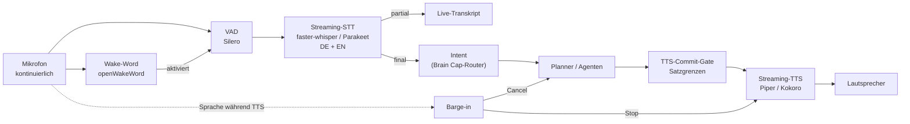

# ADR-0010 — Voice-Pipeline vollständig neu entwickeln

**Status:** Vorgeschlagen · **Kategorie:** C (neu entwickeln) · **Phase:** 4
**Betrifft:** Voice, Latenz, UX, das Kernversprechen „Voice-first"

---

## Goal

> Ein gesprochener Befehl erzeugt eine **hörbare** Reaktion in unter 1,2 Sekunden,
> auf Deutsch und Englisch, freihändig (Wake-Word), und ist jederzeit durch
> Dazwischenreden unterbrechbar.

**Messbar erreicht, wenn:** p95 Time-to-first-audio < 1,2 s; Barge-in stoppt die
Wiedergabe in < 300 ms; deutschsprachige Diktate erreichen die Zielgenauigkeit.

---

## Kontext

**OpenWorkers Voice-Fähigkeit ist Push-to-Talk-Diktat.** Vollständig verifiziert:

| Fähigkeit | Status |
|---|---|
| STT | Whisper `ggml-base.en.bin` — **Englisch only**, Batch nach Stop |
| TTS | ❌ **existiert nicht** (Volltextsuche: 0 Treffer für `tts`, `speechSynthesis`) |
| Wake-Word | ❌ 0 Treffer |
| Barge-in | ❌ 0 Treffer |
| VAD / Endpointing | ❌ — der Nutzer klickt Stop |
| Streaming-STT | ❌ — `WhisperContext.full()` über den gesamten Puffer |
| Plattform | nur Tauri (`Composer.tsx:289`: `if (!isTauri()) return`) |

Der Ablauf: Klick → aufnehmen → Klick → transkribieren → Text ins Eingabefeld → Enter.

**VibeMinds eigener Stand:** `infra/swarm/STARTUP_PROFILES.md` vermerkt für das
Voice-Modul „**native STT/TTS unvollständig**". OpenWorker schließt diese Lücke
**nicht** — nicht einmal teilweise.

---

## Entscheidung

**Vollständige Neuentwicklung.** Aus OpenWorker werden drei Dinge mitgenommen,
kein Code.

### Zielarchitektur

### Latenzbudget (p95)

| Phase | Budget |
|---|---|
| Endpoint-Erkennung (VAD) | 250 ms |
| STT-Finalisierung | 200 ms |
| Intent-Routing | 150 ms |
| LLM Time-to-first-token | 400 ms |
| TTS Time-to-first-audio | 200 ms |
| **Summe** | **1.200 ms** |

Das Budget ist die Architekturvorgabe — jede Komponentenwahl wird daran gemessen.

### Übernommen aus OpenWorker (Muster, nicht Code)

1. **Modell-Provisioning:** Download nach `.part` → SHA-256-Verifikation → Rename →
   `.verified`-Marker → Testlauf → `.ready`-Marker. Per-Read-Timeout statt
   Gesamt-Timeout, damit Abbrechen responsiv bleibt (`stt/src/lib.rs:190-228`).
   Direkt anwendbar auf alle lokalen Modelle (STT, TTS, Embeddings).
2. **Commit-Gate:** `streamGate.ts` löst „wann ist gestreamter Text eine Antwort und
   wann nur Narration" mit einer 40-Wörter-Schwelle. Für TTS ist das dieselbe Frage in
   verschärfter Form — **Gesprochenes ist nicht zurücknehmbar.** Die VibeMind-Variante
   arbeitet an Satzgrenzen und wartet ab, ob ein Tool-Call folgt.
3. **Cancellation-Invarianten** ([ADR-0003](ADR-0003-cancellation-invarianten.md)) —
   Barge-in **ist** Cancellation.

### Nicht übernommen

`ocw-stt` als Ganzes: Batch-Architektur, Englisch-only, an Push-to-Talk gebunden.
Streaming wäre keine Ergänzung, sondern eine Neuimplementierung.

---

## Begründung

- **„Voice-first" ist das Kernversprechen von VibeMind.** Ein System, das für jede
  Interaktion einen Mausklick verlangt, ist per Definition nicht Voice-first.
- **Deutschsprachiger Betrieb ist Pflicht.** `base.en` ist ausgeschlossen.
- **Die Architektur ist der Blocker, nicht die Modelle.** Der Sample-Puffer wird
  komplett gefüllt, dann komplett transkribiert. Ein Streaming-Pfad braucht anderes
  Modell, andere Pufferstrategie, VAD, Endpointing, Partial-Results,
  Confirmation-Handling.
- **Barge-in ist die härteste Anforderung** und der Grund, warum
  [ADR-0003](ADR-0003-cancellation-invarianten.md) in Phase 2 steht und nicht hier.

---

## Konsequenzen

**Positiv**
- Freihändiger Betrieb.
- Deutsch + Englisch.
- Latenzbudget macht Voice tatsächlich benutzbar.
- Barge-in erlaubt natürliche Gesprächsführung.

**Negativ / Kosten**
- **Höchster Einzelaufwand der Roadmap** (~18 PW, Phase 4A).
- **Kontinuierliches Mikrofon = Datenschutzfrage.** Wake-Word muss **lokal** laufen,
  Audio darf vor der Aktivierung den Rechner nicht verlassen. Muss sichtbar und
  abschaltbar sein.
- **Rechenlast**: Wake-Word + VAD + Streaming-STT + TTS laufen dauerhaft. Auf schwacher
  Hardware konkurriert das mit lokalen LLMs.
- **Genehmigungen per Sprache sind heikel.** „Ja" ist ein schlechter Bestätigungsakt für
  eine irreversible Aktion. Gegenmaßnahme: Für `EXTERNAL`/`DESTRUCTIVE` verpflichtende
  Rückbestätigung mit Wiederholung des Ziels („Soll ich den Bericht in Team-Daily
  posten? Sag *bestätigen*."), plus Kanalwechsel-Option.
- **Falschauslösungen** des Wake-Words sind unvermeidlich → strikte Trennung
  „aktiviert" vs. „Befehl akzeptiert".

**Risiko**
- **Latenzbudget wird nicht erreicht** (Wahrscheinlichkeit hoch). Gegenmaßnahmen:
  frühes Prototyping (4A.6 misst kontinuierlich), Fallback auf Push-to-Talk pro Space,
  kleineres STT-Modell mit nachgelagerter Korrektur.
- **Deutsche STT-Qualität** ist bei kleinen Modellen deutlich schlechter als englische.
  Gegenmaßnahme: Modellauswahl auf echten VibeMind-Befehlen evaluieren, Domänen-Vokabular
  (Space-Namen, Toolnamen, Eigennamen) als Prompt-Bias einspeisen.

---

## Alternativen

| Alternative | Bewertung |
|---|---|
| **`ocw-stt` übernehmen und erweitern** | Verworfen: Batch-Architektur, Englisch-Modell, Tauri-gebunden. Erweiterung wäre teurer als Neubau |
| **Cloud-STT/TTS** (OpenAI Realtime, Deepgram, ElevenLabs) | Bessere Qualität und Latenz, aber: Datenhoheit, laufende Kosten, Netzabhängigkeit. **Empfehlung: als optionaler Modus pro Space** — lokal als Default, Cloud als Qualitäts-Upgrade |
| **Realtime-Speech-to-Speech-Modelle** (durchgängig, ohne Text) | Sehr niedrige Latenz, aber: kein Zwischentext für Intent-Routing, kein Tool-Calling-Kontrollpunkt, keine Genehmigungsschicht. **Unvereinbar mit der Governance-Architektur** |
| **Push-to-Talk beibehalten** | Verworfen als Zielbild; **behalten als Fallback**, wenn das Latenzbudget in einem Space nicht erreichbar ist |
| **Nur STT, kein TTS** (Text-Ausgabe) | Verworfen: halbes Voice-Interface. Der Nutzer müsste zum Lesen zum Bildschirm |
